<div align="center">
  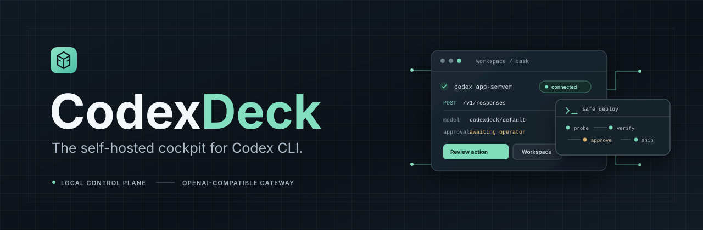
  <h1>CodexDeck</h1>
  <p>A self-hosted Codex CLI workbench and multi-protocol model gateway. Switch models, approve changes, verify deployments and share finished work from your browser.</p>
  <p><a href="README.md">简体中文</a> · <strong>English</strong></p>
  <p>
    <a href="LICENSE"></a>
    <a href="https://github.com/Waffing/codex-deck/actions/workflows/ci.yml?query=branch%3Amain"></a>
    <a href="https://github.com/Waffing/codex-deck/releases/latest"></a>
    <a href="https://github.com/Waffing/codex-deck/commits/main/"></a>
    <a href="#development"></a>
    <a href="https://github.com/Waffing/codex-deck/stargazers"></a>
  </p>
  <p>
    <a href="#api-gateway-and-workbench">API gateway</a> ·
    <a href="#features">Features</a> ·
    <a href="#screenshots">Screenshots</a> ·
    <a href="#quick-start">Quick Start</a> ·
    <a href="#architecture">Architecture</a> ·
    <a href="#security">Security</a> ·
    <a href="#open-api">Open API</a> ·
    <a href="#roadmap">Roadmap</a>
  </p>
</div>

## API gateway and workbench

Codex CLI, Claude Code and OpenAI-compatible clients can share one gateway. Open **API command center → Providers**, choose from 17 presets, enter the upstream address and credentials, then probe and import its models. Provider credentials stay in the gateway. Give each client its own token, model access and quotas.

<p align="center">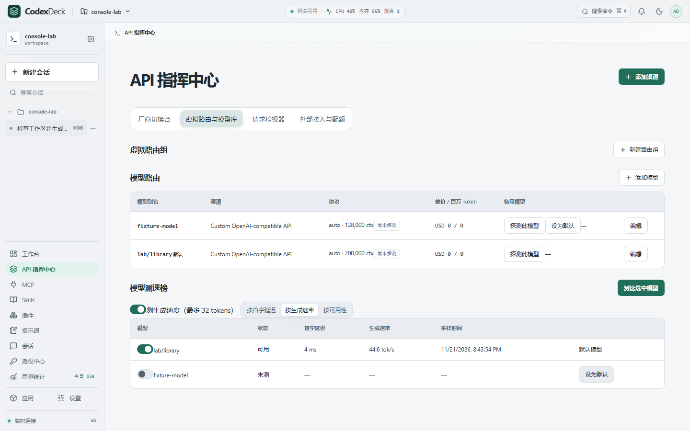</p>

| Task | Where to do it |
| --- | --- |
| Give several clients one stable model name | In **Routing and models**, group upstream targets under a virtual alias. Pick a fixed target, priority failover, weighted round-robin or lowest latency. A switch applies to the next request. |
| Investigate a slow or failed request | The **Request inspector** shows the actual model, protocol path, time to first token, cost and failover history. Redacted payload capture is off by default and expires automatically. Replay sends a short diagnostic probe. |
| Connect a CLI or SDK | **External clients and quotas** provides configurations for Codex CLI, Claude Code, the OpenAI SDK and Cursor. Issue the required `proxy:responses`, `proxy:chat`, `proxy:messages` or `proxy:models` scopes and supply the new bearer token on the client. |
| Control usage | Set model allowlists, requests and tokens per minute, and daily or monthly budgets on client keys. Provider budgets can alert or block. Provider cards show recent request outcomes and circuit state. |
| Manage the workbench | Open MCP, Skills, plugins, prompts, authorization or usage from the sidebar. Type `/` in the composer, use the arrow keys to select a command and press Enter. |

**Full-access execution.** The Docker installer selects the matching executor image and checks that the service account can start an isolated environment and run Codex CLI and Git. After sign-in, select **Full access** in the composer to run project commands without individual approvals. If the executor later becomes unavailable, the composer keeps your draft and offers a retry. Administrators can also check **Settings → Execution environment** or run `cdx executor detect` over SSH.

Native Linux and in-container fallback require a non-root service account, bubblewrap and a host policy that permits its launcher to create user namespaces. The service uses `/usr/bin/bwrap` by default. Set `CODEXDECK_BWRAP_PATH` to the absolute path of a service-specific launcher if needed. The project runs in separate PID, filesystem and network namespaces. Proxy-aware commands can connect to public HTTPS destinations on port 443.

## V1.5 artifact previews and sharing

This page describes the `main` branch. The one-line Docker installer uses the image from the latest GitHub Release. Check that tag’s notes for the features included in the image. [Run from source](#development) · [Latest release](https://github.com/Waffing/codex-deck/releases/latest)

<p align="center">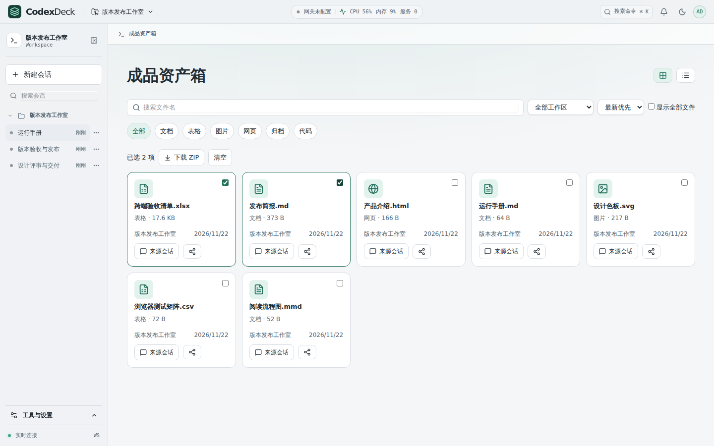</p>

| What you want to do | Where to do it |
| --- | --- |
| Find a previous deliverable | As an administrator, open **Artifact Hub** and filter by workspace, file name or type. Open the source conversation, or select files from several conversations for one ZIP download. |
| Read a file before downloading | Click a file to preview DOCX, PDF, XLS/XLSX, CSV, HTML, SVG, Markdown or Mermaid in the side drawer. Switch sheets and search within a spreadsheet. The preview limit is 32 MiB per file. |
| Find the conversation behind a phrase | Press **Ctrl+K** or **⌘K**. SQLite FTS5 searches messages, artifact names and paths, and deployment records in English and Chinese. Select a message to jump to the matching turn. |
| Send a finished document to a reader | Choose **Public share** for a read-only link to that snapshot. Links default to seven days, an empty passcode and downloads off. Set a passcode or a view limit, then extend or revoke the link under **Settings → Temporary access → Public shares**. |
| Open the workbench as an app | Visit a production build over HTTPS or localhost, then open **Settings → Appearance & workbench** for installation options. In iOS Safari, choose **Share → Add to Home Screen**. |

<details>
<summary>Coding workflow and workspace secret vault (V1.4)</summary>

| What you want to do | Where to do it |
| --- | --- |
| Agree on a plan before editing | Switch on **Plan** in the composer. Codex plans in a read-only environment. Request a revision or approve the plan to start coding. |
| Run project checks after a change | In **Workspace settings → Quality gate**, detect or enter commands such as `pnpm typecheck` and `pnpm test`. Set a repair limit from 0 to 5, inspect the redacted logs or interrupt a run. |
| Get a second model's review | Select a reviewer in **Git Diff**. Each finding has a severity and a file and line number. Send selected findings back to Codex for repair. |
| Tell Codex how a specific line should change | Click **+** beside an added or deleted line. Collect comments across files and send them together. |
| Continue in a fresh conversation | Choose **Generate handoff and start a new thread** in the thread menu. The new thread opens with the goals, changed files, constraints and remaining work, plus a link back to the source thread. |
| Supply environment variables for tests or deployment | Import the project's `.env` in **Workspace settings → Environment vault**. Enable each key separately for verification or deployment. The vault encrypts values and gives the conversation only the available key names. |

Automatic verification is opt-in. Checks run offline by default in a copy of the workspace. Docker runs each gate in a separate container. Native Linux installations need a systemd user manager and `/usr/bin/bwrap`. Guest and Open API checks run without vault credentials. An administrator can review the workspace and rerun checks with the selected credentials.

</details>

## Quick Start

**Install the latest release with Docker Compose on Linux (amd64 or arm64).** This command installs the image corresponding to the latest GitHub Release. [Release notes](https://github.com/Waffing/codex-deck/releases/latest) · [GHCR images and tags](https://github.com/Waffing/codex-deck/pkgs/container/codex-deck)

```sh
release=$(curl -fsSL -o /dev/null -w '%{url_effective}' https://github.com/Waffing/codex-deck/releases/latest) && tag=${release##*/} && curl -fsSL "https://raw.githubusercontent.com/Waffing/codex-deck/$tag/deploy/install.sh" | CODEXDECK_VERSION="$tag" bash
```

**First sign-in.** Follow the address and setup instructions printed by your installer. For Docker release `v0.1.1`, run `docker compose exec codexdeck cat /data/setup-code` in the installation directory. Enter the one-time code in the setup wizard and create your administrator password. Versions that include the V1.2 host tools use `cdx password` over SSH. For public access and certificate fingerprint checks, see the [host operations guide](deploy/HOST-ADMIN.md).

Managed application containers default to 1 CPU, 512 MiB of memory, and 128 processes. `CODEXDECK_RELEASE_KEEP` retains five recent snapshots by default, while the live release and its immediate rollback predecessor stay protected. On restart the controller adopts only containers carrying CodexDeck ownership labels.

`tag` selects the same published release for the installer, Compose files and Docker image. To install a specific version, set `tag` to its published `vX.Y.Z` before running the following command. Add `--with-playwright` for Chromium verification.

```sh
tag="${CODEXDECK_VERSION:-$(curl -fsSL -o /dev/null -w '%{url_effective}' https://github.com/Waffing/codex-deck/releases/latest)}"; tag="${tag##*/}"; curl -fsSL "https://raw.githubusercontent.com/Waffing/codex-deck/$tag/deploy/install.sh" | CODEXDECK_VERSION="$tag" bash -s -- --with-playwright
```

**Native Linux with systemd**. Install Node.js 22.13+, Corepack, Git and the official Codex CLI system-wide. A dedicated build account installs dependencies. The `codexdeck` service account runs the release. At the default install location, retrieve the first-run code with `sudo cat /opt/codexdeck/source/data/setup-code`.

```sh
tag="${CODEXDECK_VERSION:-$(curl -fsSL -o /dev/null -w '%{url_effective}' https://github.com/Waffing/codex-deck/releases/latest)}"; tag="${tag##*/}"; curl -fsSL "https://raw.githubusercontent.com/Waffing/codex-deck/$tag/deploy/install.sh" | CODEXDECK_VERSION="$tag" bash -s -- --native
```

**Local CLI with npx.** The `codex-deck` name on npm belongs to a different project. After building the checkout, point npx at this repository's `packages/cli` and run it in offline mode.

```sh
git clone https://github.com/Waffing/codex-deck.git
cd codex-deck
pnpm install --frozen-lockfile
pnpm build
mkdir -p ./data ./workspaces
(
  umask 077
  if [ ! -s ./data/master.key ]; then
    openssl rand -hex 32 > ./data/master.key
  fi
)
export CODEXDECK_MASTER_KEY="$(cat ./data/master.key)"
NODE_ENV=production npx --offline --yes --package=./packages/cli -- codex-deck start --port 3000 --data ./data --workspaces ./workspaces
```

From the checkout in a second terminal, read `./data/setup-code` for first setup. Run `npx --offline --yes --package=./packages/cli -- codex-deck status` to check the service. Replace `status` with `doctor` to inspect runtime prerequisites.

<details>
<summary>HTTPS, upgrades and backups</summary>

For managed Caddy, select public mode and a domain, then opt in when the installer confirms the required ports are available. Configure DNS and forward public TCP 80 and 443 to host ports 8080 and 8443. On an existing web host, `cdx proxy panel.example.com` prints an independent reverse-proxy configuration and checks the public certificate. Set `CODEXDECK_TRUSTED_PROXIES` to the exact proxy peer seen by CodexDeck and configure the proxy to overwrite forwarded headers.

Run `cdx` for the host menu or use `cdx tasks`, `cdx kill THREAD`, `cdx public on`, `cdx backup` and `cdx restore SNAPSHOT`. `cdx security` reads the same settings as the browser. Apply a JSON patch with `printf '%s' '{"max_failures":6}' | cdx security set`. With the Docker service stopped, recovery uses the installed image and database and requires a running Docker daemon. See the [host operations guide](deploy/HOST-ADMIN.md).

Run the installed `install.sh --upgrade --dir /path/to/install --version vX.Y.Z` for a published target, or `--uninstall --dir /path/to/install` to remove the service. Add `--native` for systemd. The installer retains the running image or service unit for health-check rollback. Take a database backup before upgrading across schema versions.

From the Docker install directory, use Python 3 with read access to the data and workspace mounts. Substitute your configured host paths. Keep the destination outside both source directories. Pause workspace edits during the snapshot. SQLite may continue receiving writes.

```sh
archive="$PWD/backup-$(date +%Y%m%d-%H%M%S)"
python3 backup.py backup --data ./data --workspaces ./workspaces --managed-data /data --managed-workspaces /workspaces --to "$archive"
python3 backup.py verify --from "$archive"
python3 backup.py restore --from "$archive" --to ./recovery --target-data /data --target-workspaces /workspaces
```

Point `CODEXDECK_DATA_PATH` and `CODEXDECK_WORKSPACES_HOST` at the restored `recovery/data` and `recovery/workspaces` before starting the replacement stack. For a native installation, back up `source/data` and the configured workspace path, omit the two `--managed-*` flags and set `--target-data` and `--target-workspaces` to the service’s final absolute paths. Grant the service account ownership of the restored directories. Backups include project files and history. Encrypt them at rest and store the matching master key separately. Verification checks hashes and SQLite integrity. Symlinks in included paths require a filesystem snapshot.

For key rotation, back up first, stop the service and supply the new random 32-byte key as `CODEXDECK_NEXT_MASTER_KEY` through your secret manager. Docker supplies the current key from its configuration. Run `docker compose stop codexdeck` then `docker compose run --rm --no-deps -e CODEXDECK_NEXT_MASTER_KEY codexdeck node apps/server/dist/rotate-key.js /data`. For native installs, stop systemd and run `node apps/server/dist/rotate-key.js /opt/codexdeck/source/data` from the installed release as the service account with both keys in its environment. After the database transaction succeeds, update the stored `CODEXDECK_MASTER_KEY` to the new value and restart. Retrying with the same two keys recognizes a committed rotation. Sign back in, reissue download links and refresh webhook signing secrets.

</details>

## Features

| Need | How CodexDeck handles it |
| --- | --- |
| Use a provider that speaks Chat Completions | Codex speaks Responses to a local gateway. The gateway forwards native Responses or translates streaming and tool calls to Chat Completions, with configured fallback models. |
| Keep provider credentials out of agent processes | The gateway decrypts provider credentials for upstream requests. Codex authenticates to the local gateway with a signed, short-lived token. |
| Stay in control while the agent works | Decisions from `codex app-server` appear as non-blocking approval cards. The requested operation waits for a decision while the console remains usable. |
| Deliver artifacts and keep an audit trail | Inspect files and Git checkpoints, follow resumable events, and share scoped, expiring artifact download links. |
| Verify deployments before committing to a release | Server Probe checks available runtimes. Stage a deployment, verify HTTP and logs, optionally run Playwright checks, then promote with rollback on verification failure. |
| Approve work away from your desk | The responsive console shows tasks, approvals, logs and service previews on a phone. |

## Screenshots

Playwright captures these views using a demo project. After CI passes on a push to `main`, GitHub Actions publishes the corresponding screenshots to the media branch. [Screenshot history](https://github.com/Waffing/codex-deck/commits/codexdeck-media/)

<table>
  <tr>
    <td width="75%">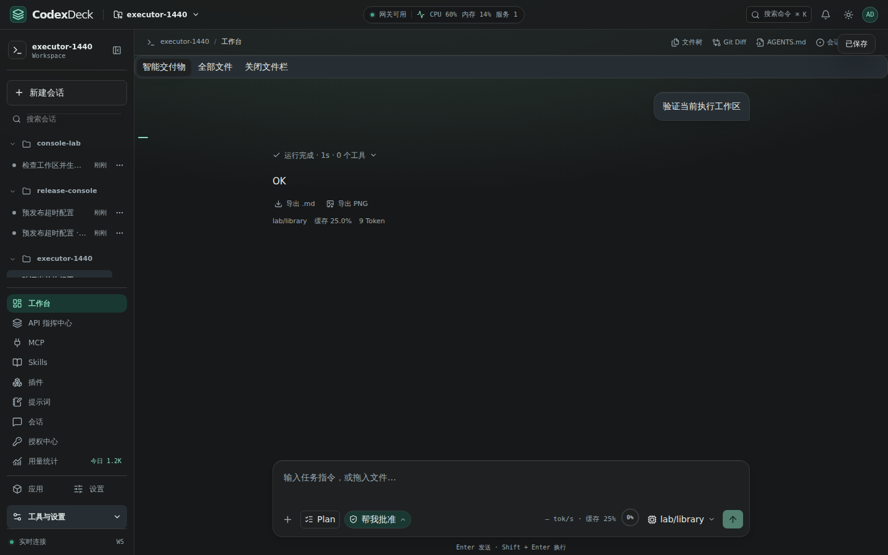</td>
    <td width="25%">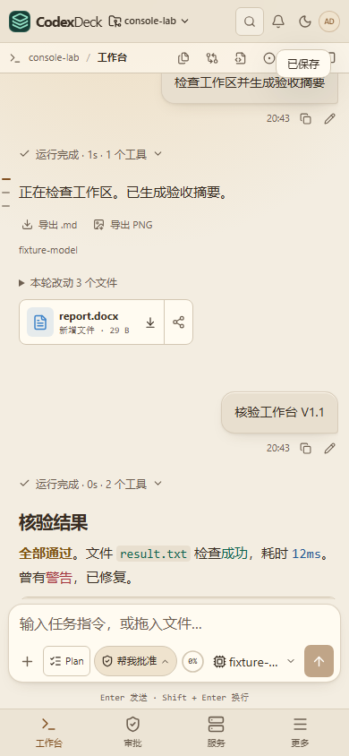</td>
  </tr>
  <tr><td>Desktop · Midnight Pine</td><td>Mobile · Warm Paper</td></tr>
</table>

<table>
  <tr>
    <td width="50%">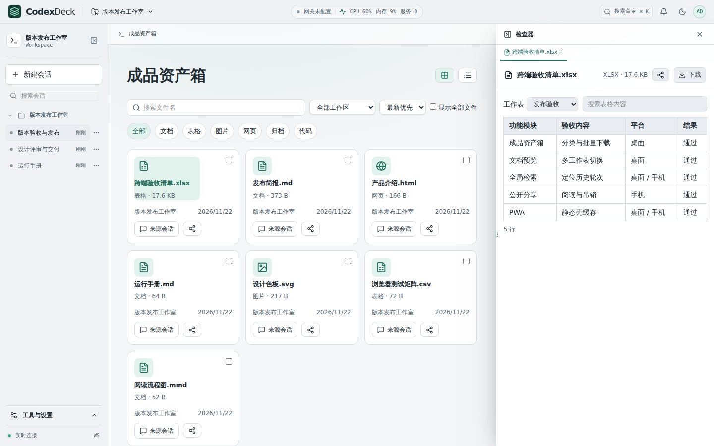</td>
    <td width="50%">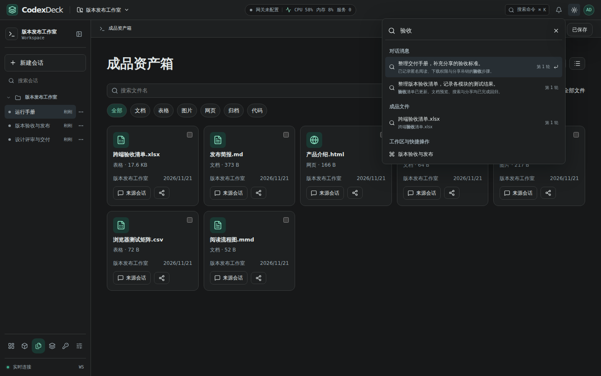</td>
  </tr>
  <tr><td>Inspect a release checklist</td><td>Find a historical conversation</td></tr>
</table>

<p align="center">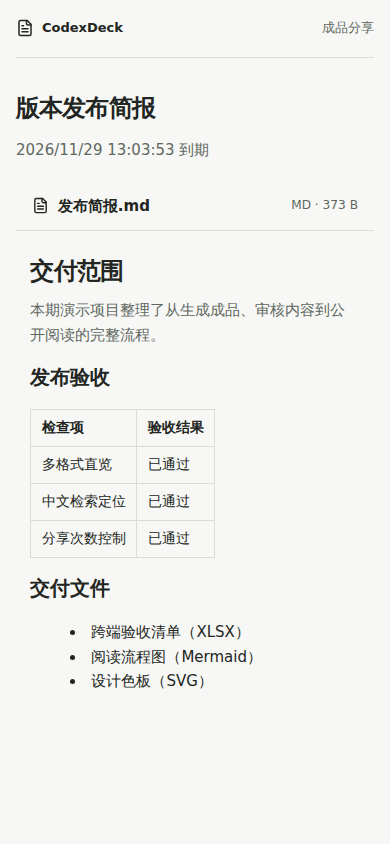<br>A public share on mobile</p>

<details>
<summary>See the workbench, approvals, cross-model review and secret vault</summary>

<p align="center">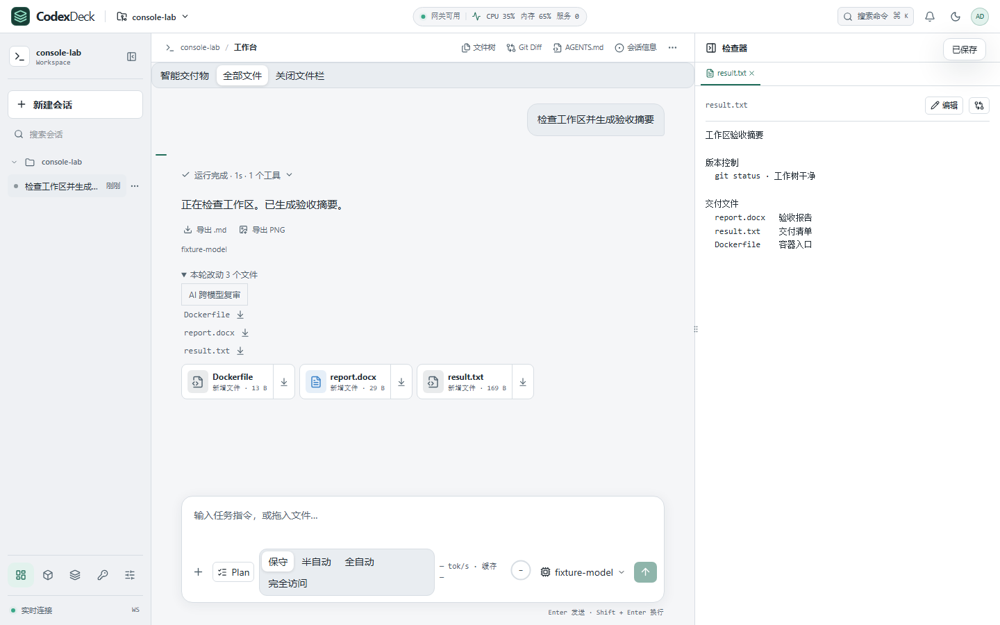</p>

<table>
  <tr>
    <td width="50%">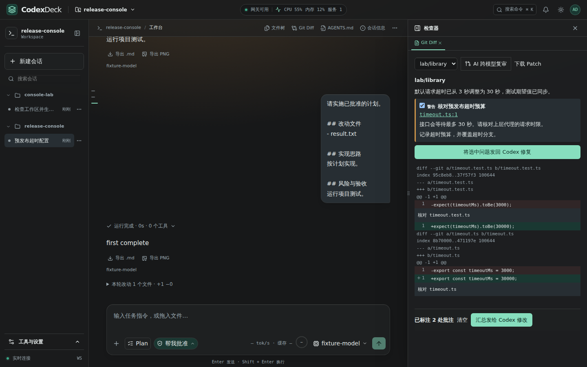</td>
    <td width="50%">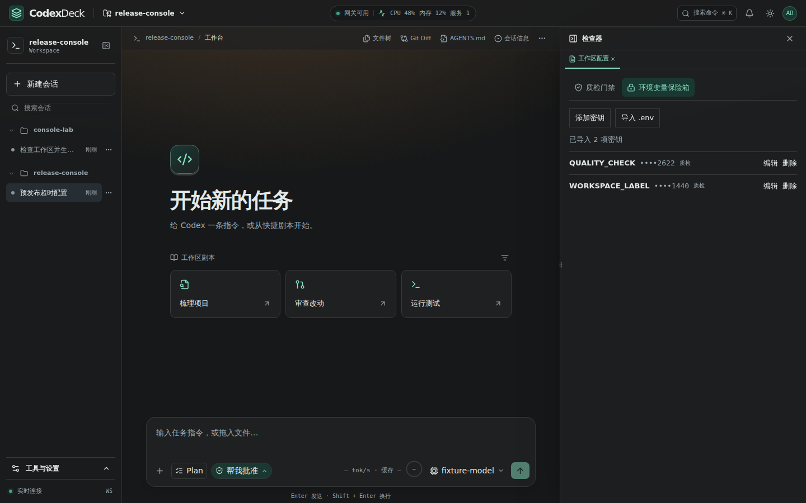</td>
  </tr>
  <tr><td>Cross-model diff review</td><td>Workspace environment vault</td></tr>
</table>

<table>
  <tr>
    <td align="center">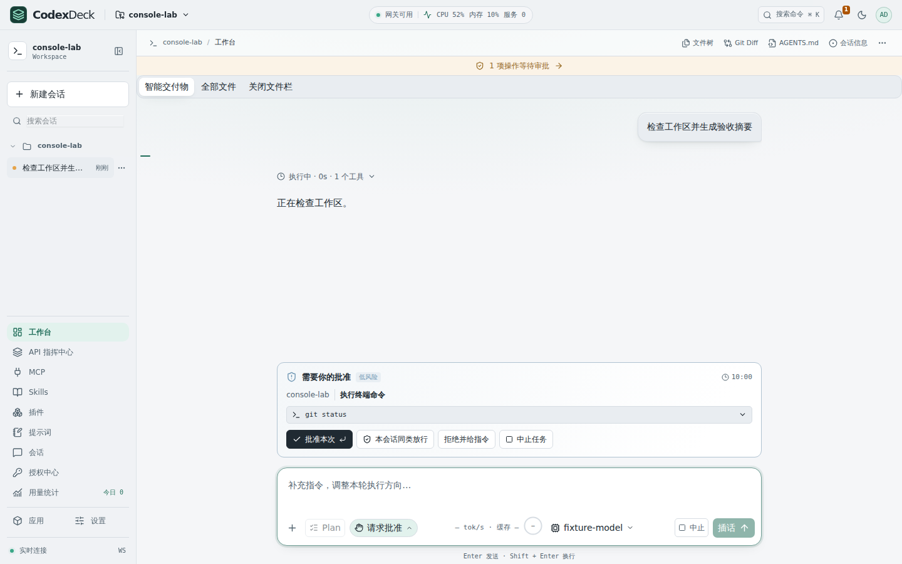</td>
    <td align="center">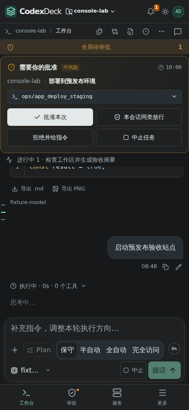</td>
  </tr>
  <tr><td align="center">Desktop approval</td><td align="center">Mobile approval</td></tr>
</table>

</details>

## Architecture

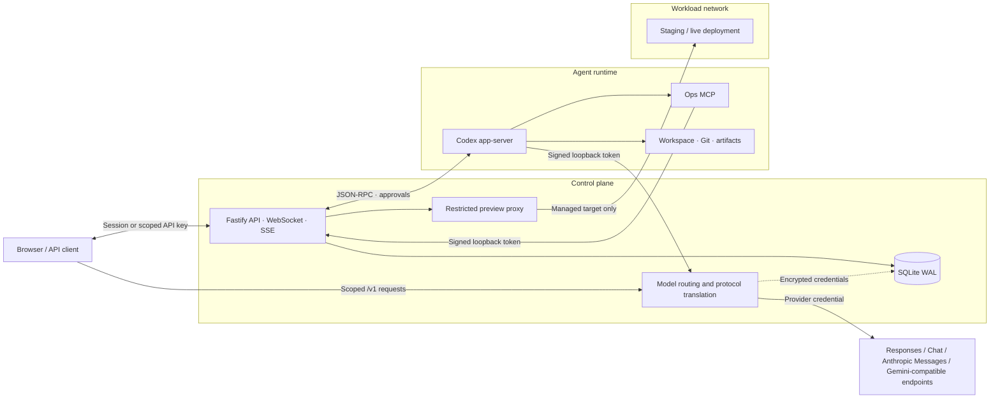

In Docker, the control plane accesses the Docker API through a socket proxy on a separate internal network. Workloads and Caddy share the workload network. Caddy forwards external traffic to the control plane, which resolves preview and live deployment targets.

## Third-party API compatibility

| Provider preset | Supported path in CodexDeck | Recommended mode |
| --- | --- | --- |
| OpenAI | Responses passthrough or Chat translation when the selected model supports it | `auto`, or `responses` for a verified native model |
| Anthropic | Messages streaming, tool calls and tool results | Select the Anthropic preset and an upstream model ID |
| Gemini | OpenAI-compatible endpoint | Select the Gemini preset and an upstream model ID |
| OneAPI / NewAPI | OpenAI-compatible relay. Upstream routing determines which endpoints and features are available. | `auto` after probing. Use `chat` for a Chat-only relay. |
| OpenRouter | Model-dependent Responses or Chat support | `auto` after probing the selected model |
| DeepSeek | OpenAI-compatible Chat Completions | `chat`, with tool support verified per model |
| Ollama | OpenAI-compatible endpoints on a reachable Ollama instance | `auto` after probing, or `chat` on a Chat-only server |

Run the provider probe for the actual model and endpoint before relying on streaming, tools or vision. With Ollama on the Docker host, set its provider URL to `http://host.docker.internal:11434/v1` and allow only `http://host.docker.internal:11434` in `CODEXDECK_TRUSTED_HTTP_ORIGINS`. Configure Ollama to accept traffic from the Docker bridge. Use HTTPS for external providers.

## Security

1. **Credential isolation.** AES-256-GCM protects provider keys and custom header values in SQLite. The gateway decrypts them for upstream requests, and Codex receives only a local gateway token. Production requires a persistent `CODEXDECK_MASTER_KEY`.
2. **Filesystem boundaries.** `realpath` and root containment checks protect workspace files, database files and exported artifacts from path traversal through symlinks.
3. **Docker API limits.** The control plane uses an internal `docker-socket-proxy` with an endpoint allowlist. Docker write access remains a privileged host capability.
4. **Preview SSRF controls.** The proxy resolves managed deployment targets, checks staging access and port ownership, and strips browser credentials. Browser verification restricts requests to the deployment origin.
5. **Secret masking.** `SecretMasker` redacts recognized credentials from logs, persisted thread events and events sent to clients.
6. **Production deployment boundary.** Host-process deployments are disabled in production by default. Use Docker or Compose for managed workloads. Enable `CODEXDECK_ALLOW_LOCAL_DEPLOYMENTS=true` only on an explicitly isolated development machine.
7. **Document previews and public shares.** HTML and SVG render in an opaque-origin iframe with `sandbox="allow-scripts"` and a strict Content Security Policy on the file response. External readers reach shares through enabled public access over verified HTTPS. Each reading credential is scoped to one share.
8. **PWA asset cache.** The service worker caches only build-listed scripts, styles, fonts and icons. API calls, WebSocket connections, public shares, signed downloads and previews go to the server.

See [SECURITY.md](SECURITY.md) for private vulnerability reporting.

## Open API

Create an Open API key in the **Authorization center**. Grant `tasks:write`, `tasks:read` and access to the target workspace. Export `CODEXDECK_API_KEY` and `WORKSPACE_ID` from your local environment. These Bash examples require `curl` and `jq`.

```bash
export CODEXDECK_URL=http://127.0.0.1:3000
JOB_KEY=$(openssl rand -hex 16)
: "${CODEXDECK_API_KEY:?Set CODEXDECK_API_KEY}"
: "${WORKSPACE_ID:?Set WORKSPACE_ID}"

TASK_ID=$(
  curl -fsS "$CODEXDECK_URL/api/v1/tasks" \
    -H "Authorization: Bearer $CODEXDECK_API_KEY" \
    -H "Idempotency-Key: $JOB_KEY" \
    -H "Content-Type: application/json" \
    --data "$(jq -nc --arg id "$WORKSPACE_ID" \
      '{workspace_id: $id, prompt: "Summarize the project and list its test commands."}')" \
  | jq -er '.task_id'
)

curl -fNsS "$CODEXDECK_URL/api/v1/tasks/$TASK_ID/stream" \
  -H "Authorization: Bearer $CODEXDECK_API_KEY" \
  -H "Last-Event-ID: 0"
```

Task creation returns HTTP `202` and includes `task_id` and `thread_id`. Keep the same `JOB_KEY` and body when retrying one logical job. Generate a new key for a new job. Use the last processed SSE event ID when reconnecting. Query `GET /api/v1/tasks/{task_id}` for status and artifacts. Artifact URLs require `files:download`. An optional allowlisted `webhook_url` receives signed task callbacks.

## Development

Use Node.js 22.13+, Corepack with the pinned pnpm version, and Git. The official Codex CLI is required for real agent tasks.

```sh
corepack enable
pnpm install --frozen-lockfile
pnpm typecheck
pnpm build
pnpm test
```

Run `pnpm dev:server` and `pnpm dev:web` in separate terminals. The API defaults to `127.0.0.1:3210`. Vite proxies API, WebSocket and preview requests in development. Run `pnpm e2e` with a compatible Playwright Chromium installation to exercise the console against local fixtures.

## Roadmap

- [x] **V1 foundations** · Protocol gateway, provider key isolation, approvals, signed artifacts, Open API and deployment verification.
- [x] **V1 console** · Desktop workbench, mobile approvals, provider probes and resumable events.
- [x] **V1.1 models and usage** · Multi-key rotation, model benchmarks, context compaction and per-turn usage.
- [x] **V1.2 access control** · Public access, device session management and workspace-scoped guest invitations.
- [x] **V1.3 workbench validation** · Paged history, local caching, optimistic sends and opt-in isolated execution per workspace.
- [x] **V1.4 quality gates and vault** · Read-only plans, verification and repair, cross-model review, line comments, thread handoffs and scoped workspace secrets.
- [x] **V1.5 documents and delivery** · File previews, a cross-conversation Artifact Hub, Chinese and English full-text search, revocable public shares and PWA installation.
- [x] **Workbench and gateway on main** · Four themes, three approval modes, sidebar modules, multi-protocol routing, redacted request inspection and per-client quotas.
- [ ] **npm distribution** · Choose an available package name and publish the CLI.
- [ ] **V2 plans** · Strengthen workload isolation, expand provider compatibility coverage and improve deployment recovery.

## Contributing & License

See the [contribution guide](CONTRIBUTING.md) for checks and pull requests. CodexDeck is available under the [MIT license](LICENSE).

[](https://star-history.com/#Waffing/codex-deck&Date)

