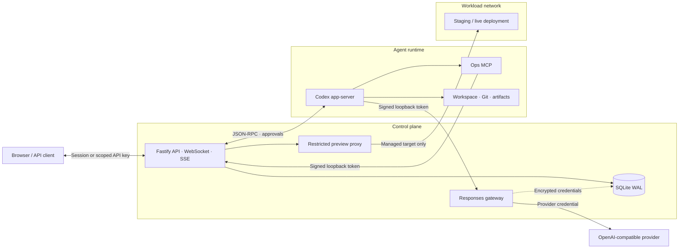

<div align="center">
  
  <h1>CodexDeck</h1>
  <p>A self-hosted web cockpit for Codex CLI with an OpenAI-compatible model gateway, remote approvals, and verified deployments.</p>
  <p><a href="README.md">简体中文</a> · <strong>English</strong></p>
  <p>
    <a href="LICENSE"></a>
    <a href="https://github.com/Waffing/codex-deck/actions/workflows/ci.yml"></a>
    <a href="https://github.com/Waffing/codex-deck/pkgs/container/codex-deck"></a>
    <a href="#development"></a>
    <a href="https://github.com/Waffing/codex-deck/stargazers"></a>
  </p>
  <p>
    <a href="#features">Features</a> ·
    <a href="#quick-start">Quick Start</a> ·
    <a href="#architecture">Architecture</a> ·
    <a href="#security">Security</a> ·
    <a href="#open-api">Open API</a> ·
    <a href="#roadmap">Roadmap</a>
  </p>
</div>

## Quick Start

**Docker Compose on Linux (amd64 or arm64)**

```sh
release=$(curl -fsSL -o /dev/null -w '%{url_effective}' https://github.com/Waffing/codex-deck/releases/latest) && tag=${release##*/} && curl -fsSL "https://raw.githubusercontent.com/Waffing/codex-deck/$tag/deploy/install.sh" | CODEXDECK_VERSION="$tag" bash
```

The V1.2 installer defaults to a loopback console on `127.0.0.1:3000`. Set the first administrator password over SSH with `cdx password`, open the printed SSH tunnel, then sign in and choose a provider and workspace. Pass `--local-only` to select this mode in scripts. Select `--public` for an additional high-port HTTPS listener and an eight-character entrance path. For direct IP access, compare the certificate fingerprint against `cdx status` over SSH before trusting the certificate. These options require a release containing V1.2.

Managed application containers default to 1 CPU, 512 MiB of memory, and 128 processes. `CODEXDECK_RELEASE_KEEP` retains five recent snapshots by default, while the live release and its immediate rollback predecessor stay protected. On restart the controller adopts only containers carrying CodexDeck ownership labels.

`tag` selects the same published release for the installer, Compose files and Docker image. To install a specific version, set `tag` to its published `vX.Y.Z` before running the following command. Add `--with-playwright` for Chromium verification.

```sh
tag="${CODEXDECK_VERSION:-$(curl -fsSL -o /dev/null -w '%{url_effective}' https://github.com/Waffing/codex-deck/releases/latest)}"; tag="${tag##*/}"; curl -fsSL "https://raw.githubusercontent.com/Waffing/codex-deck/$tag/deploy/install.sh" | CODEXDECK_VERSION="$tag" bash -s -- --with-playwright
```

**Native Linux with systemd**. Install Node.js 22.13+, Corepack, Git and the official Codex CLI system-wide. A dedicated build account installs dependencies. The `codexdeck` service account runs the release. At the default install location, retrieve the first-run code with `sudo cat /opt/codexdeck/source/data/setup-code`.

```sh
tag="${CODEXDECK_VERSION:-$(curl -fsSL -o /dev/null -w '%{url_effective}' https://github.com/Waffing/codex-deck/releases/latest)}"; tag="${tag##*/}"; curl -fsSL "https://raw.githubusercontent.com/Waffing/codex-deck/$tag/deploy/install.sh" | CODEXDECK_VERSION="$tag" bash -s -- --native
```

**Local CLI with npx.** The `codex-deck` name on npm belongs to a different project. After building the checkout, point npx at this repository's `packages/cli` and run it in offline mode.

```sh
git clone https://github.com/Waffing/codex-deck.git
cd codex-deck
pnpm install --frozen-lockfile
pnpm build
mkdir -p ./data ./workspaces
(
  umask 077
  if [ ! -s ./data/master.key ]; then
    openssl rand -hex 32 > ./data/master.key
  fi
)
export CODEXDECK_MASTER_KEY="$(cat ./data/master.key)"
NODE_ENV=production npx --offline --yes --package=./packages/cli -- codex-deck start --port 3000 --data ./data --workspaces ./workspaces
```

From the checkout in a second terminal, read `./data/setup-code` for first setup. Run `npx --offline --yes --package=./packages/cli -- codex-deck status` to check the service. Replace `status` with `doctor` to inspect runtime prerequisites.

<details>
<summary>HTTPS, upgrades and backups</summary>

For managed Caddy, select public mode and a domain, then opt in when the installer confirms the required ports are available. Configure DNS and forward public TCP 80 and 443 to host ports 8080 and 8443. On an existing web host, `cdx proxy panel.example.com` prints an independent reverse-proxy configuration and checks the public certificate. Set `CODEXDECK_TRUSTED_PROXIES` to the exact proxy peer seen by CodexDeck and configure the proxy to overwrite forwarded headers.

Run `cdx` for the host menu or use `cdx tasks`, `cdx kill THREAD`, `cdx public on`, `cdx backup` and `cdx restore SNAPSHOT`. `cdx security` reads the same settings as the browser. Apply a JSON patch with `printf '%s' '{"max_failures":6}' | cdx security set`. With the Docker service stopped, recovery uses the installed image and database and requires a running Docker daemon. See the [host operations guide](deploy/HOST-ADMIN.md).

Run the installed `install.sh --upgrade --dir /path/to/install --version vX.Y.Z` for a published target, or `--uninstall --dir /path/to/install` to remove the service. Add `--native` for systemd. The installer retains the running image or service unit for health-check rollback. Take a database backup before upgrading across schema versions.

From the Docker install directory, use Python 3 with read access to the data and workspace mounts. Substitute your configured host paths. Keep the destination outside both source directories. Pause workspace edits during the snapshot. SQLite may continue receiving writes.

```sh
archive="$PWD/backup-$(date +%Y%m%d-%H%M%S)"
python3 backup.py backup --data ./data --workspaces ./workspaces --managed-data /data --managed-workspaces /workspaces --to "$archive"
python3 backup.py verify --from "$archive"
python3 backup.py restore --from "$archive" --to ./recovery --target-data /data --target-workspaces /workspaces
```

Point `CODEXDECK_DATA_PATH` and `CODEXDECK_WORKSPACES_HOST` at the restored `recovery/data` and `recovery/workspaces` before starting the replacement stack. For a native installation, back up `source/data` and the configured workspace path, omit the two `--managed-*` flags and set `--target-data` and `--target-workspaces` to the service’s final absolute paths. Grant the service account ownership of the restored directories. Backups include project files and history. Encrypt them at rest and store the matching master key separately. Verification checks hashes and SQLite integrity. Symlinks in included paths require a filesystem snapshot.

For key rotation, back up first, stop the service and supply the new random 32-byte key as `CODEXDECK_NEXT_MASTER_KEY` through your secret manager. Docker supplies the current key from its configuration. Run `docker compose stop codexdeck` then `docker compose run --rm --no-deps -e CODEXDECK_NEXT_MASTER_KEY codexdeck node apps/server/dist/rotate-key.js /data`. For native installs, stop systemd and run `node apps/server/dist/rotate-key.js /opt/codexdeck/source/data` from the installed release as the service account with both keys in its environment. After the database transaction succeeds, update the stored `CODEXDECK_MASTER_KEY` to the new value and restart. Retrying with the same two keys recognizes a committed rotation. Sign back in, reissue download links and refresh webhook signing secrets.

</details>

## Features

| Need | How CodexDeck handles it |
| --- | --- |
| Use a provider that speaks Chat Completions | Codex speaks Responses to a local gateway. The gateway forwards native Responses or translates streaming and tool calls to Chat Completions, with configured fallback models. |
| Keep provider credentials out of agent processes | The gateway decrypts provider credentials for upstream requests. Codex authenticates to the local gateway with a signed, short-lived token. |
| Stay in control while the agent works | Decisions from `codex app-server` appear as non-blocking approval cards. The requested operation waits for a decision while the console remains usable. |
| Deliver artifacts and keep an audit trail | Inspect files and Git checkpoints, follow resumable events, and share scoped, expiring artifact download links. |
| Verify deployments before committing to a release | Server Probe checks available runtimes. Stage a deployment, verify HTTP and logs, optionally run Playwright checks, then promote with rollback on verification failure. |
| Approve work away from your desk | The responsive console shows tasks, approvals, logs and service previews on a phone. |

<p align="center">
  
</p>

<table>
  <tr>
    <td align="center"></td>
    <td align="center"></td>
  </tr>
  <tr><td align="center">Desktop approval</td><td align="center">Mobile approval</td></tr>
</table>

*Screenshots show the local console with synthetic test data.*

## Architecture



In Docker, the control plane accesses the Docker API through a socket proxy on a separate internal network. Workloads and Caddy share the workload network. Caddy forwards external traffic to the control plane, which resolves preview and live deployment targets.

## Third-party API compatibility

| Provider preset | Supported path in CodexDeck | Recommended mode |
| --- | --- | --- |
| OpenAI | Responses passthrough or Chat translation when the selected model supports it | `auto`, or `responses` for a verified native model |
| OneAPI / NewAPI | OpenAI-compatible relay. Upstream routing determines which endpoints and features are available. | `auto` after probing. Use `chat` for a Chat-only relay. |
| OpenRouter | Model-dependent Responses or Chat support | `auto` after probing the selected model |
| DeepSeek | OpenAI-compatible Chat Completions | `chat`, with tool support verified per model |
| Ollama | OpenAI-compatible endpoints on a reachable Ollama instance | `auto` after probing, or `chat` on a Chat-only server |

Run the provider probe for the actual model and endpoint before relying on streaming, tools or vision. With Ollama on the Docker host, set its provider URL to `http://host.docker.internal:11434/v1` and allow only `http://host.docker.internal:11434` in `CODEXDECK_TRUSTED_HTTP_ORIGINS`. Configure Ollama to accept traffic from the Docker bridge. Use HTTPS for external providers.

## Security

1. **Credential isolation.** AES-256-GCM protects provider keys and custom header values in SQLite. The gateway decrypts them for upstream requests, and Codex receives only a local gateway token. Production requires a persistent `CODEXDECK_MASTER_KEY`.
2. **Filesystem boundaries.** `realpath` and root containment checks protect workspace files, database files and exported artifacts from path traversal through symlinks.
3. **Docker API limits.** The control plane uses an internal `docker-socket-proxy` with an endpoint allowlist. Docker write access remains a privileged host capability.
4. **Preview SSRF controls.** The proxy resolves managed deployment targets, checks staging access and port ownership, and strips browser credentials. Browser verification restricts requests to the deployment origin.
5. **Secret masking.** `SecretMasker` redacts recognized credentials from logs, persisted thread events and events sent to clients.
6. **Production deployment boundary.** Host-process deployments are disabled in production by default. Use Docker or Compose for managed workloads. Enable `CODEXDECK_ALLOW_LOCAL_DEPLOYMENTS=true` only on an explicitly isolated development machine.

See [SECURITY.md](SECURITY.md) for private vulnerability reporting.

## Open API

Create an API key in the console's **Open API 与用量** page. Grant `tasks:write`, `tasks:read` and access to the target workspace. Export `CODEXDECK_API_KEY` and `WORKSPACE_ID` from your local environment. These Bash examples require `curl` and `jq`.

```bash
export CODEXDECK_URL=http://127.0.0.1:3000
JOB_KEY=$(openssl rand -hex 16)
: "${CODEXDECK_API_KEY:?Set CODEXDECK_API_KEY}"
: "${WORKSPACE_ID:?Set WORKSPACE_ID}"

TASK_ID=$(
  curl -fsS "$CODEXDECK_URL/api/v1/tasks" \
    -H "Authorization: Bearer $CODEXDECK_API_KEY" \
    -H "Idempotency-Key: $JOB_KEY" \
    -H "Content-Type: application/json" \
    --data "$(jq -nc --arg id "$WORKSPACE_ID" \
      '{workspace_id: $id, prompt: "Summarize the project and list its test commands."}')" \
  | jq -er '.task_id'
)

curl -fNsS "$CODEXDECK_URL/api/v1/tasks/$TASK_ID/stream" \
  -H "Authorization: Bearer $CODEXDECK_API_KEY" \
  -H "Last-Event-ID: 0"
```

Task creation returns HTTP `202` and includes `task_id` and `thread_id`. Keep the same `JOB_KEY` and body when retrying one logical job. Generate a new key for a new job. Use the last processed SSE event ID when reconnecting. Query `GET /api/v1/tasks/{task_id}` for status and artifacts. Artifact URLs require `files:download`. An optional allowlisted `webhook_url` receives signed task callbacks.

## Development

Use Node.js 22.13+, Corepack with the pinned pnpm version, and Git. The official Codex CLI is required for real agent tasks.

```sh
corepack enable
pnpm install --frozen-lockfile
pnpm typecheck
pnpm build
pnpm test
```

Run `pnpm dev:server` and `pnpm dev:web` in separate terminals. The API defaults to `127.0.0.1:3210`. Vite proxies API, WebSocket and preview requests in development. Run `pnpm e2e` with a compatible Playwright Chromium installation to exercise the console against local fixtures.

## Roadmap

- [x] **V1 foundations** · Protocol gateway, provider key isolation, approvals, signed artifacts, Open API and deployment verification.
- [x] **V1 console** · Desktop workbench, mobile approvals, provider probes and resumable events.
- [ ] **Release validation** · Track release-specific CI results and smoke tests on both target architectures. Select an available npm package name.
- [ ] **V2 plans** · Strengthen workload isolation, expand provider compatibility coverage and improve deployment recovery.

## Contributing & License

See the [contribution guide](CONTRIBUTING.md) for checks and pull requests. CodexDeck is available under the [MIT license](LICENSE).

[](https://star-history.com/#Waffing/codex-deck&Date)

