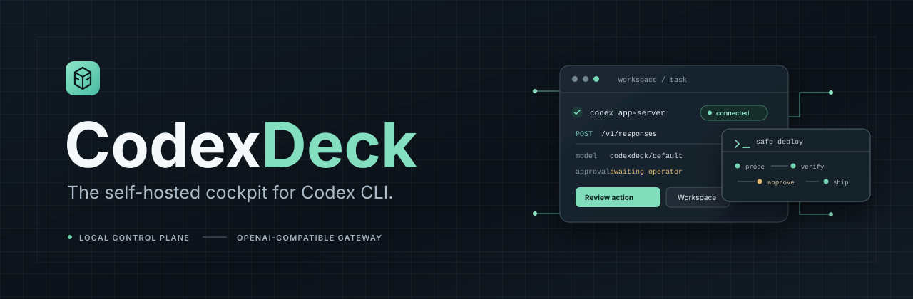
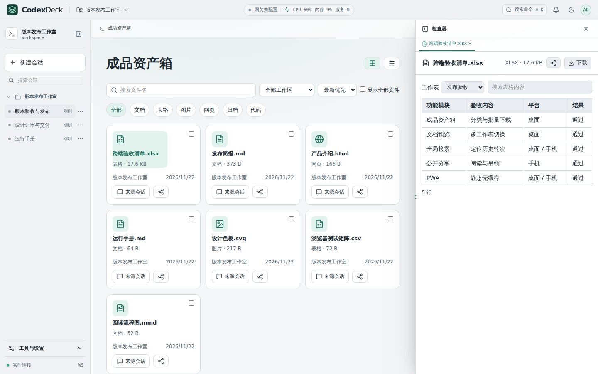
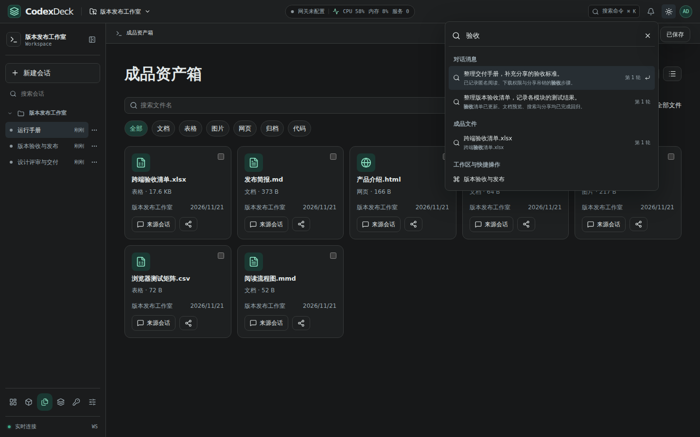
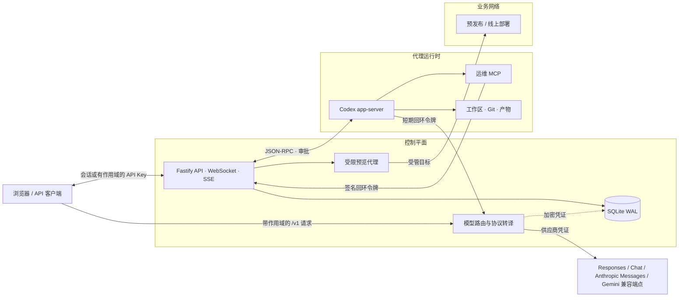

<div align="center">
  
  <h1>CodexDeck</h1>
  <p>自托管 Codex CLI 工作台与多协议模型网关。在浏览器里切换模型、审批代码操作、验证部署，把成品分享给读者。</p>
  <p><strong>简体中文</strong> · <a href="README.en.md">English</a></p>
  <p>
    <a href="LICENSE"></a>
    <a href="https://github.com/Waffing/codex-deck/actions/workflows/ci.yml?query=branch%3Amain"></a>
    <a href="https://github.com/Waffing/codex-deck/releases/latest"></a>
    <a href="https://github.com/Waffing/codex-deck/commits/main/"></a>
    <a href="#本地开发"></a>
    <a href="https://github.com/Waffing/codex-deck/stargazers"></a>
  </p>
  <p>
    <a href="#api-指挥中心与工作台">API 指挥中心</a> ·
    <a href="#核心功能">核心功能</a> ·
    <a href="#界面预览">界面预览</a> ·
    <a href="#快速开始">快速开始</a> ·
    <a href="#系统架构">系统架构</a> ·
    <a href="#安全模型">安全模型</a> ·
    <a href="#open-api">Open API</a> ·
    <a href="#路线图">路线图</a>
  </p>
</div>

## API 指挥中心与工作台

Codex CLI、Claude Code 和 OpenAI 兼容客户端可以共用一个模型网关。打开侧栏的 **API 指挥中心**，在 **服务总览** 查看运行中的服务、已启用的渠道和有效客户端 Key。要接入第三方 API，进入 **供应商**，选择预设、填写上游地址和凭证，探测连接后导入模型。

<p align="center"></p>

| 操作 | 入口与结果 |
| --- | --- |
| 临时停用一个供应商 | 在 **供应商** 点“停用”查看受影响的模型、会话、备用路线和默认模型，再确认。已有引用会保留，可以随时重新启用。要让依赖它的请求继续工作，先在 **模型与路由** 更换上游或配置可用备用模型。 |
| 给多个客户端提供稳定的模型名 | 在 **模型与路由** 将多个实际模型编为一个虚拟模型。支持手动固定、优先级故障转移、加权轮询和最低延迟。切换目标从下一个请求生效。 |
| 诊断失败或慢请求 | **请求与账本** 显示实际模型、协议、首字延迟、成本和切流过程。临时抓包默认关闭，管理员开启后可查看脱敏报文，到期自动关闭。重放使用短探针。 |
| 接入 CLI 或 SDK | 在 **客户端接入** 复制 Codex CLI、Claude Code、OpenAI SDK 和 Cursor 的配置。为客户端分配所需的 `proxy:responses`、`proxy:chat`、`proxy:messages` 或 `proxy:models` 权限，在客户端填写签发的 Bearer Token。 |
| 管理成本和可用性 | 设置 Key 的模型白名单、每分钟请求数、每分钟 Token 数、日／月预算。厂商可选预算告警或阻断，健康点阵和熔断状态显示在厂商卡片上。 |
| 管理工作台 | 从侧栏进入 MCP、Skills、插件、提示词、授权中心和用量统计。在输入框使用 `/` 选择命令，方向键和 Enter 可完成操作。 |

**完全访问的执行环境。** Docker 一键安装会自动选用同版执行镜像，并在报告安装成功前验证服务账户能启动隔离环境、运行 Codex CLI 和 Git。登录后直接在输入框选择 **完全访问权限**，项目内命令即可免逐条审批。若执行器后来失效，工作台保留草稿并提供重新检测。管理员也可以在 **设置 → 执行环境** 或通过 SSH 运行 `cdx executor detect` 查看结果。

Linux 原生安装和容器内回退需要非 root 服务账户、bubblewrap 和允许该启动器创建用户命名空间的主机策略。服务默认使用 `/usr/bin/bwrap`，也支持通过 `CODEXDECK_BWRAP_PATH` 指定服务专用启动器的绝对路径。当前项目挂载在独立的 PID、文件系统和网络命名空间内。支持代理的命令可通过 HTTPS 连接公网 443 端口。

## V1.5 成品预览与分享

本文展示 `main` 的功能。Docker 一键安装命令使用最新 GitHub Release 对应的镜像，具体功能见该标签的发布说明。[从源码运行](#本地开发) · [最新正式版](https://github.com/Waffing/codex-deck/releases/latest)

<p align="center"></p>

| 要做什么 | 在哪里操作 |
| --- | --- |
| 找回上次交付的文件 | 管理员打开 **成品资产箱**，按工作区、文件名或类型筛选，回到来源会话，也可把多个会话的文件打包成一个 ZIP。 |
| 先看内容再下载 | 点击文件，在右侧抽屉查看 DOCX、PDF、XLS/XLSX、CSV、HTML、SVG、Markdown 或 Mermaid。表格可切换工作表并搜索。单文件预览上限为 32 MiB。 |
| 从一句话找到历史对话 | 按 **Ctrl+K** 或 **⌘K** 搜索中英文关键词。SQLite FTS5 检索消息、成品名称与路径、部署记录。选择消息会滚动到命中的那一轮。 |
| 把成品发给读者 | 点击 **公开分享**，生成固定到当前快照的只读链接。默认 7 天有效、免提取码、关闭原件下载。可设置提取码和阅读次数上限，也可在设置的 **临时访问管理 → 公开分享** 中续期或吊销。 |
| 在桌面或手机上打开工作台 | 使用 HTTPS 或本机地址访问生产构建，在 **设置 → 外观与工作台** 查看安装入口。iOS Safari 可从分享菜单选择 **添加到主屏幕**。 |

<details>
<summary>编码工作流与项目密钥保险箱（V1.4）</summary>

| 你要做什么 | 在工作台如何操作 |
| --- | --- |
| 先定计划再改代码 | 在输入框打开 **Plan 模式**。Codex 在只读环境中规划，你可以提交修改意见，也可以批准计划开始编码。 |
| 改完自动运行项目检查 | 在 **工作区配置 → 质检门禁** 中识别或填写命令，如 `pnpm typecheck` 和 `pnpm test`。自愈上限可设为 0 至 5 次，运行时可中止或查看脱敏日志。 |
| 请另一个模型审查改动 | 在 **Git Diff** 中选择复审模型。按严重度和文件行号查看问题，勾选后可发回 Codex 修复。 |
| 指出某一行应该怎样改 | 点击新增行或删除行旁的 **+**，跨文件留下意见，再一次发送所有批注。 |
| 把未完工作交给新会话 | 在会话菜单选择 **生成交接单并开新会话**。新会话携带目标、改动文件、约束和待办，可返回来源会话查阅细节。 |
| 给测试或部署提供环境变量 | 在 **工作区配置 → 环境变量保险箱** 导入项目 `.env`，按键分别授权质检或部署注入。保险箱加密保存值，Codex 对话只接收可用键名。 |

自动质检默认关闭。启用后，命令在工作区副本中运行，默认离线。Docker 使用独立容器，Linux 原生安装需要 systemd 用户服务和 `/usr/bin/bwrap`。访客和 Open API 任务的自动质检使用无密钥环境，管理员复核工作区后可带所选密钥重跑。

</details>

## 快速开始

**安装最新正式版 · Linux Docker Compose（amd64 或 arm64）**。下面的命令始终安装最新 GitHub Release 对应的镜像。[发布说明](https://github.com/Waffing/codex-deck/releases/latest) · [GHCR 镜像与标签](https://github.com/Waffing/codex-deck/pkgs/container/codex-deck)

```sh
release=$(curl -fsSL -o /dev/null -w '%{url_effective}' https://github.com/Waffing/codex-deck/releases/latest) && tag=${release##*/} && curl -fsSL "https://raw.githubusercontent.com/Waffing/codex-deck/$tag/deploy/install.sh" | CODEXDECK_VERSION="$tag" bash
```

首次在 Debian/Ubuntu 或 DNF/YUM 系 Linux 安装时，脚本会补齐 Docker/Compose 与 curl、CA 证书、OpenSSL、Git、jq、Python、ripgrep 和 Nginx。新装 Nginx 保持停用，不覆盖站点配置或监听 80/443。公网 HTTPS 使用独立高位端口，安装完成后按输出在云安全组放行该 TCP 端口。

**首次登录**请按安装器输出的地址和初始化命令操作。使用 `v0.1.1` 的 Docker 安装时，在安装目录执行 `docker compose exec codexdeck cat /data/setup-code`，将一次性代码填入设置向导并创建管理员密码。使用包含 V1.2 宿主机工具的版本时，通过 SSH 运行 `cdx password`。公网入口和证书指纹的核对方法见[宿主机运维指南](deploy/HOST-ADMIN.md)。

公网安装请在提示时启用公网访问。安装器会打印包含 HTTPS 端口和随机入口路径的完整地址，必须使用该地址访问。根路径返回伪装 404 是入口保护的预期行为。还需在云厂商安全组放行安装器显示的 TCP 端口；安装器不会改动系统防火墙或占用 80/443。

`tag` 让安装脚本、Compose 文件和镜像使用同一已发布版本。指定版本时，把 `tag` 改成已发布的 `vX.Y.Z`。需要 Chromium 验收时追加 `--with-playwright`。

每个托管业务容器默认限制为 1 CPU、512 MiB 内存和 128 个进程。`CODEXDECK_RELEASE_KEEP` 默认保留 5 个最近快照，线上版本及其上一版本会额外受保护。服务重启后只恢复带有 CodexDeck 所有权标签的业务容器。

```sh
tag="${CODEXDECK_VERSION:-$(curl -fsSL -o /dev/null -w '%{url_effective}' https://github.com/Waffing/codex-deck/releases/latest)}"; tag="${tag##*/}"; curl -fsSL "https://raw.githubusercontent.com/Waffing/codex-deck/$tag/deploy/install.sh" | CODEXDECK_VERSION="$tag" bash -s -- --with-playwright
```

**Linux 原生安装（systemd）**。安装器会补齐 Node.js 22.13+、Corepack、Git、官方 Codex CLI、bubblewrap、构建工具和 Nginx 软件包。新装的 Nginx 默认站点保持停用，避免接管系统 80/443 端口。独立构建账户负责安装依赖，`codexdeck` 服务账户运行发布版本。默认目录下用 `sudo cat /opt/codexdeck/source/data/setup-code` 读取首次启动代码。

```sh
tag="${CODEXDECK_VERSION:-$(curl -fsSL -o /dev/null -w '%{url_effective}' https://github.com/Waffing/codex-deck/releases/latest)}"; tag="${tag##*/}"; curl -fsSL "https://raw.githubusercontent.com/Waffing/codex-deck/$tag/deploy/install.sh" | CODEXDECK_VERSION="$tag" bash -s -- --native
```

**使用 npx 运行本地 CLI**。npm 上的 `codex-deck` 已被另一个项目使用。构建源码后，将 npx 指向本仓库的 `packages/cli`，以离线模式启动。

```sh
git clone https://github.com/Waffing/codex-deck.git
cd codex-deck
pnpm install --frozen-lockfile
pnpm build
mkdir -p ./data ./workspaces
(
  umask 077
  if [ ! -s ./data/master.key ]; then
    openssl rand -hex 32 > ./data/master.key
  fi
)
export CODEXDECK_MASTER_KEY="$(cat ./data/master.key)"
NODE_ENV=production npx --offline --yes --package=./packages/cli -- codex-deck start --port 3000 --data ./data --workspaces ./workspaces
```

在另一个终端进入仓库根目录，读取 `./data/setup-code` 完成首次设置。运行 `npx --offline --yes --package=./packages/cli -- codex-deck status` 查看服务状态，将 `status` 换成 `doctor` 检查运行环境。

<details>
<summary>HTTPS、升级和备份</summary>

在公网模式指定域名后，若相关端口均空闲，可在安装器中选择托管 Caddy。配置 DNS，并将公网 TCP 80 和 443 分别转发到宿主机 8080 和 8443。已有网站的服务器可执行 `cdx proxy panel.example.com`，生成独立反代配置片段并检查公网证书。请将 `CODEXDECK_TRUSTED_PROXIES` 设为面板实际看到的代理 IP，并由该代理覆盖转发头。

执行 `cdx` 打开管理菜单。常用命令有 `cdx tasks`、`cdx kill THREAD`、`cdx public on`、`cdx backup` 和 `cdx restore 备份文件名`。Web 与 SSH 共用安全配置，例如 `printf '%s' '{"max_failures":6}' | cdx security set` 将连续失败上限改为 6 次。Docker 面板容器停止时，恢复操作使用本机已有镜像和数据库，需 Docker 守护进程可用。[宿主机运维指南](deploy/HOST-ADMIN.md)

运行安装目录的 `install.sh --upgrade --dir /path/to/install --version vX.Y.Z` 升级指定已发布版本，传入 `--uninstall --dir /path/to/install` 卸载，systemd 部署沿用 `--native`。升级会保留正在运行的镜像或服务单元，健康检查失败时回滚。跨数据库架构版本升级前先备份。

```sh
archive="$PWD/backup-$(date +%Y%m%d-%H%M%S)"
python3 backup.py backup --data ./data --workspaces ./workspaces --managed-data /data --managed-workspaces /workspaces --to "$archive"
python3 backup.py verify --from "$archive"
python3 backup.py restore --from "$archive" --to ./recovery --target-data /data --target-workspaces /workspaces
```

恢复后将 `CODEXDECK_DATA_PATH` 和 `CODEXDECK_WORKSPACES_HOST` 指向 `recovery/data` 与 `recovery/workspaces`。原生安装备份 `source/data` 和实际工作区路径，并使用服务最终绝对路径作为 `--target-data`、`--target-workspaces`。恢复目录需要归属服务账户。备份包含项目文件和历史记录，必须加密保存并单独保管匹配的主密钥。校验会检查哈希和 SQLite 完整性，包含符号链接的项目需要使用文件系统快照。

密钥轮换前先备份并停止服务。用密钥管理器提供新的随机 32 字节值到 `CODEXDECK_NEXT_MASTER_KEY`，执行 `docker compose stop codexdeck`，再运行 `docker compose run --rm --no-deps -e CODEXDECK_NEXT_MASTER_KEY codexdeck node apps/server/dist/rotate-key.js /data`。原生安装停止 systemd 后，在安装版本目录执行同名命令。事务成功后将 `CODEXDECK_MASTER_KEY` 替换为新值并重启。重复使用同一对密钥会识别已提交轮换，旧会话、下载链接和 webhook 签名需要重新建立。

</details>

## 核心功能

| 需求 | CodexDeck 的处理方式 |
| --- | --- |
| 接入仅支持 Chat Completions 的模型 | Codex 使用 Responses 协议访问本地网关。网关可以原样转发 Responses，也可将流式输出和工具调用转为 Chat Completions，并支持配置备用模型。 |
| 将供应商凭证与代理进程隔离 | 网关在发送上游请求时解密凭证。Codex 通过短期签名令牌访问本地网关。 |
| 在任务运行时审批敏感操作 | `codex app-server` 的审批请求以非阻塞卡片显示。待审操作暂停期间，控制台仍可继续使用。 |
| 交付产物并保留审计记录 | 检查文件和 Git 检查点，订阅可续传的任务事件，通过有作用域且会过期的签名链接下载产物。 |
| 部署后先验收再确认上线 | Server Probe 检查可用运行时。部署至预发布、检查 HTTP 和日志，按需启用 Playwright，并在发布验收失败时回滚。 |
| 离开电脑后继续审批 | 响应式控制台可在手机上查看任务、审批、日志和服务预览。 |

## 界面预览

Playwright 在演示项目中拍摄以下界面。主分支推送通过 CI 后，GitHub Actions 会把对应截图发布到媒体分支。[截图更新记录](https://github.com/Waffing/codex-deck/commits/codexdeck-media/)

<table>
  <tr>
    <td width="75%"></td>
    <td width="25%"></td>
  </tr>
  <tr><td>桌面 · 午夜松林</td><td>手机 · 暖纸阅读</td></tr>
</table>

<table>
  <tr>
    <td width="50%"></td>
    <td width="50%"></td>
  </tr>
  <tr><td>在抽屉中查看发布清单</td><td>从搜索结果回到历史对话</td></tr>
</table>

<p align="center"><br>手机上的成品分享页</p>

<details>
<summary>查看对话工作台、审批、跨模型复审和保险箱截图</summary>

<p align="center"></p>

<table>
  <tr>
    <td width="50%"></td>
    <td width="50%"></td>
  </tr>
  <tr><td>跨模型 Diff 复审</td><td>项目环境变量保险箱</td></tr>
</table>

<table>
  <tr>
    <td align="center"></td>
    <td align="center"></td>
  </tr>
  <tr><td align="center">桌面审批</td><td align="center">移动端审批</td></tr>
</table>

</details>

## 系统架构



Docker 模式下，控制平面通过独立内部网络上的 socket proxy 调用 Docker API。业务容器与 Caddy 位于业务网络。Caddy 将外部请求转发给控制平面，由控制平面解析预览和线上部署目标。

## 第三方 API 兼容矩阵

| 供应商预设 | CodexDeck 接入能力 | 推荐模式 |
| --- | --- | --- |
| OpenAI | 根据所选模型使用 Responses 透传或 Chat 转译 | `auto`，或对已验证的原生模型使用 `responses` |
| Anthropic | Messages 流式输出、工具调用和工具结果 | 使用 Anthropic 预设及对应的真实模型 ID |
| Gemini | OpenAI 兼容端点 | 使用 Gemini 预设及对应的真实模型 ID |
| OneAPI / NewAPI | 兼容 OpenAI 的中转，端点和功能由上游路由决定 | 探测后用 `auto`，仅支持 Chat 的中转用 `chat` |
| OpenRouter | 可用的 Responses / Chat 端点取决于所选模型 | 探测所选模型后使用 `auto` |
| DeepSeek | 兼容 OpenAI 的 Chat Completions | `chat`，工具调用能力按模型确认 |
| Ollama | 可达的 Ollama 实例提供兼容 OpenAI 的端点 | 探测后用 `auto`，仅支持 Chat 的实例用 `chat` |

接入真实端点后请运行供应商探测，按模型确认流式输出、工具调用和图片能力。Docker 宿主机上的 Ollama 可使用 `http://host.docker.internal:11434/v1`，并在 `CODEXDECK_TRUSTED_HTTP_ORIGINS` 只加入 `http://host.docker.internal:11434`。公网供应商使用 HTTPS。

## 安全模型

1. **凭证隔离。** 供应商 Key 和自定义请求头以 AES-256-GCM 加密存入 SQLite。网关为上游请求解密，Codex 只收到本地网关令牌。生产环境需要保留固定的 `CODEXDECK_MASTER_KEY`。
2. **文件访问边界。** 使用 `realpath` 检查工作区、数据库和导出产物的根目录边界，防止通过符号链接穿越目录。
3. **Docker 接口最小权限。** 控制平面通过内部网络的 `docker-socket-proxy` 使用允许的 Docker 接口。Docker 写权限仍属于宿主机高权限能力。
4. **预览代理的 SSRF 防护。** 代理只解析受管部署目标，检查预发布权限和端口归属，剥离浏览器凭证。浏览器验收限制请求访问部署本身的来源。
5. **凭证脱敏。** `SecretMasker` 对日志、持久化线程事件和发送给客户端的事件遮罩可识别的凭证。
6. **生产部署边界。** 生产环境默认禁用宿主机进程部署，受管业务应使用 Docker 或 Compose。只有明确隔离的开发机才应设置 `CODEXDECK_ALLOW_LOCAL_DEPLOYMENTS=true`。
7. **文档预览与公开分享。** HTML 和 SVG 在启用 `allow-scripts` 的独立来源沙箱 iframe 中显示，文件响应带严格 CSP。外部读者通过已启用的公网入口和经验证的 HTTPS 访问分享页，阅读凭证只对对应分享有效。
8. **PWA 静态缓存。** Service Worker 只缓存构建清单中的脚本、样式、字体和图标。API、WebSocket、分享内容、签名下载和预览请求由服务器处理。

漏洞请按 [SECURITY.md](SECURITY.md) 私下报告。

## Open API

在**授权中心**创建 Open API Key，并授权 `tasks:write`、`tasks:read` 与目标工作区。将 Key 和工作区 ID 放入本地环境变量 `CODEXDECK_API_KEY` 和 `WORKSPACE_ID`。以下 Bash 示例需要 `curl` 与 `jq`。

```bash
export CODEXDECK_URL=http://127.0.0.1:3000
JOB_KEY=$(openssl rand -hex 16)
: "${CODEXDECK_API_KEY:?请设置 CODEXDECK_API_KEY}"
: "${WORKSPACE_ID:?请设置 WORKSPACE_ID}"

TASK_ID=$(
  curl -fsS "$CODEXDECK_URL/api/v1/tasks" \
    -H "Authorization: Bearer $CODEXDECK_API_KEY" \
    -H "Idempotency-Key: $JOB_KEY" \
    -H "Content-Type: application/json" \
    --data "$(jq -nc --arg id "$WORKSPACE_ID" \
      '{workspace_id: $id, prompt: "概述项目并列出测试命令。"}')" \
  | jq -er '.task_id'
)

curl -fNsS "$CODEXDECK_URL/api/v1/tasks/$TASK_ID/stream" \
  -H "Authorization: Bearer $CODEXDECK_API_KEY" \
  -H "Last-Event-ID: 0"
```

创建任务返回 HTTP `202`，响应包含 `task_id` 和 `thread_id`。同一个逻辑任务重试时保留 `JOB_KEY` 与请求体，新任务需生成新 Key。SSE 重连时传入最后处理的事件 ID。通过 `GET /api/v1/tasks/{task_id}` 查询状态和产物，读取签名下载地址还需 `files:download` 权限。任务可设置白名单中的 `webhook_url` 来接收签名回调。

## 本地开发

使用 Node.js 22.13+、Corepack 管理的固定 pnpm 版本以及 Git。执行真实代理任务还需要官方 Codex CLI。

```sh
corepack enable
pnpm install --frozen-lockfile
pnpm typecheck
pnpm build
pnpm test
```

在不同终端运行 `pnpm dev:server` 和 `pnpm dev:web`。API 默认监听 `127.0.0.1:3210`，Vite 会代理开发环境的 API、WebSocket 和预览请求。安装兼容的 Playwright Chromium 后，可运行 `pnpm e2e` 使用本地测试夹具验收控制台。

## 路线图

- [x] **V1 基础能力** · 协议网关、凭证隔离、审批、签名产物、Open API 和部署验收。
- [x] **V1 控制台** · 桌面工作台、移动端审批、供应商探测和可续传事件。
- [x] **V1.1 模型与账本** · 多 Key 轮询、模型测速、上下文压缩和按回合统计用量。
- [x] **V1.2 访问控制** · 公网入口、设备会话管理和限定工作区的访客链接。
- [x] **V1.3 工作台验收** · 历史分页、本地缓存、即时发送和按工作区启用的隔离执行。
- [x] **V1.4 质量门禁与保险箱** · 只读计划、自动质检和修复、跨模型复审、逐行批注、会话交接、项目密钥按用途注入。
- [x] **V1.5 文档与交付** · 文档直览、跨会话资产箱、中英文全文检索、可吊销的成品分享和 PWA 安装。
- [x] **主分支工作台与模型网关** · 四套皮肤、三档审批、模块导航、多协议路由、脱敏请求检视与按客户端配置的配额。
- [ ] **npm 分发** · 选定可用包名并发布 CLI。
- [ ] **V2 规划** · 加强业务容器隔离、扩充供应商兼容性覆盖并改进部署恢复。

## 贡献与许可证

参阅[贡献指南](CONTRIBUTING.md)了解检查和提交流程。CodexDeck 使用 [MIT 许可证](LICENSE)。

[](https://star-history.com/#Waffing/codex-deck&Date)

