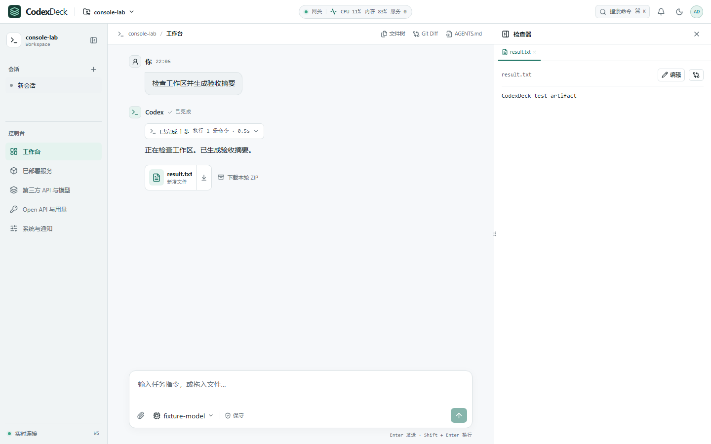
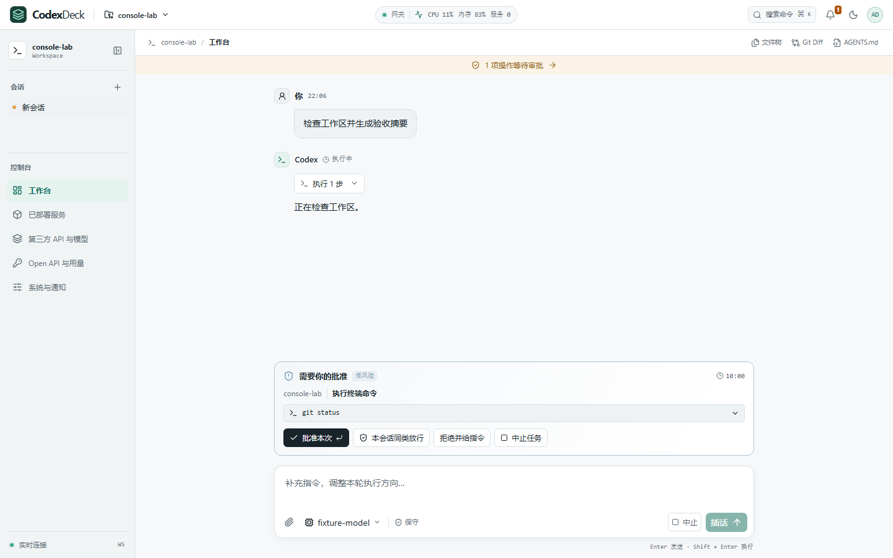
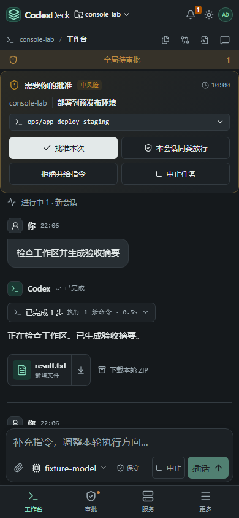
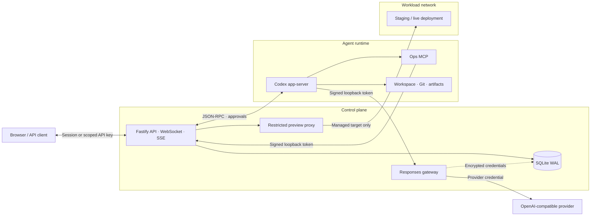

<div align="center">
  
  <h1>CodexDeck</h1>
  <p>A self-hosted web cockpit for Codex CLI with an OpenAI-compatible model gateway, remote approvals, and verified deployments.</p>
  <p><strong>English</strong> · <a href="README.zh-CN.md">简体中文</a></p>
  <p>
    <a href="LICENSE"></a>
    <a href="https://github.com/Waffing/codex-deck/actions/workflows/ci.yml"></a>
    <a href="https://github.com/Waffing/codex-deck/pkgs/container/codex-deck"></a>
    <a href="#development"></a>
    <a href="https://github.com/Waffing/codex-deck/stargazers"></a>
  </p>
  <p>
    <a href="#features">Features</a> ·
    <a href="#quick-start">Quick Start</a> ·
    <a href="#architecture">Architecture</a> ·
    <a href="#security">Security</a> ·
    <a href="#open-api">Open API</a> ·
    <a href="#roadmap">Roadmap</a>
  </p>
</div>

## Quick Start

**Docker Compose on Linux (amd64 or arm64)**

```sh
curl -fsSL https://raw.githubusercontent.com/Waffing/codex-deck/main/deploy/install.sh | bash
```

The installer provisions Docker and the Compose plugin when needed. It creates a persistent data directory and uses `127.0.0.1:3000` by default. Open that address and complete the setup wizard to create an administrator, configure and probe a provider, and select a workspace. Run initial setup over a trusted connection before exposing the console.

The Docker command requires the first public image release. Source and native installs are available from `main`. The container registry publishes `ghcr.io/waffing/codex-deck:latest` and `ghcr.io/waffing/codex-deck:latest-playwright` when a version tag triggers the release workflow. Select the Playwright image for Chromium-based verification.

```sh
curl -fsSL https://raw.githubusercontent.com/Waffing/codex-deck/main/deploy/install.sh | bash -s -- --with-playwright
```

**Native Linux with systemd**. Install Node.js 22+, Corepack, Git and the official Codex CLI where the `codexdeck` service account can run them.

```sh
curl -fsSL https://raw.githubusercontent.com/Waffing/codex-deck/main/deploy/install.sh | bash -s -- --native
```

**Local CLI with npx.** The `codex-deck` name on npm belongs to a different project. After building the checkout, point npx at this repository's `packages/cli` and run it in offline mode.

```sh
git clone https://github.com/Waffing/codex-deck.git
cd codex-deck
pnpm install --frozen-lockfile
pnpm build
mkdir -p ./data ./workspaces
(
  umask 077
  if [ ! -s ./data/master.key ]; then
    openssl rand -hex 32 > ./data/master.key
  fi
)
export CODEXDECK_MASTER_KEY="$(cat ./data/master.key)"
NODE_ENV=production npx --offline --yes --package=./packages/cli -- codex-deck start --port 3000 --data ./data --workspaces ./workspaces
```

From the checkout in a second terminal, use `npx --offline --yes --package=./packages/cli -- codex-deck status` to check the running service. Replace `status` with `doctor` to inspect runtime prerequisites.

<details>
<summary>HTTPS, upgrades and backups</summary>

For the Compose HTTPS profile, configure DNS and forward public TCP ports 80 and 443 to host ports 8080 and 8443. Pass `--domain codex.example.com` to the installer to enable Caddy. The application remains on a loopback host binding.

Use the [installer](deploy/install.sh) with `--upgrade --dir /path/to/install` to update in place, or `--uninstall --dir /path/to/install` to remove the service. Use the same `--native` mode flag for systemd installations. Back up your persistent data and workspace directories along with the encryption key and protect the key separately. It is required to decrypt provider credentials after a restore.

</details>

## Features

| Need | How CodexDeck handles it |
| --- | --- |
| Use a provider that speaks Chat Completions | Codex speaks Responses to a local gateway. The gateway forwards native Responses or translates streaming and tool calls to Chat Completions, with configured fallback models. |
| Keep provider credentials out of agent processes | The gateway decrypts provider credentials for upstream requests. Codex authenticates to the local gateway with a signed, short-lived token. |
| Stay in control while the agent works | Decisions from `codex app-server` appear as non-blocking approval cards. The requested operation waits for a decision while the console remains usable. |
| Deliver artifacts and keep an audit trail | Inspect files and Git checkpoints, follow resumable events, and share scoped, expiring artifact download links. |
| Verify deployments before committing to a release | Server Probe checks available runtimes. Stage a deployment, verify HTTP and logs, optionally run Playwright checks, then promote with rollback on verification failure. |
| Approve work away from your desk | The responsive console shows tasks, approvals, logs and service previews on a phone. |

<p align="center">
  
</p>

<table>
  <tr>
    <td align="center"></td>
    <td align="center"></td>
  </tr>
  <tr><td align="center">Desktop approval</td><td align="center">Mobile approval</td></tr>
</table>

*Screenshots show the local console with synthetic test data.*

## Architecture



In Docker, the control plane accesses the Docker API through a socket proxy on a separate internal network. Workloads and Caddy share the workload network. Caddy forwards external traffic to the control plane, which resolves preview and live deployment targets.

## Third-party API compatibility

| Provider preset | Supported path in CodexDeck | Recommended mode |
| --- | --- | --- |
| OpenAI | Responses passthrough or Chat translation when the selected model supports it | `auto`, or `responses` for a verified native model |
| OneAPI / NewAPI | OpenAI-compatible relay. Upstream routing determines which endpoints and features are available. | `auto` after probing. Use `chat` for a Chat-only relay. |
| OpenRouter | Model-dependent Responses or Chat support | `auto` after probing the selected model |
| DeepSeek | OpenAI-compatible Chat Completions | `chat`, with tool support verified per model |
| Ollama | OpenAI-compatible endpoints on a reachable Ollama instance | `auto` after probing, or `chat` on a Chat-only server |

Provider presets configure gateway behavior. Run the provider probe for the actual model and endpoint before relying on streaming, tools or vision.

## Security

1. **Credential isolation.** AES-256-GCM protects provider keys and custom header values in SQLite. The gateway decrypts them for upstream requests, and Codex receives only a local gateway token. Production requires a persistent `CODEXDECK_MASTER_KEY`.
2. **Filesystem boundaries.** `realpath` and root containment checks protect workspace files, database files and exported artifacts from path traversal through symlinks.
3. **Docker API limits.** The control plane uses an internal `docker-socket-proxy` with an endpoint allowlist. Docker write access remains a privileged host capability.
4. **Preview SSRF controls.** The proxy resolves managed deployment targets, checks staging access and port ownership, and strips browser credentials. Browser verification restricts requests to the deployment origin.
5. **Secret masking.** `SecretMasker` redacts recognized credentials from logs, persisted thread events and events sent to clients.

See [SECURITY.md](SECURITY.md) for private vulnerability reporting.

## Open API

Create an API key in the console's **Open API 与用量** page. Grant `tasks:write`, `tasks:read` and access to the target workspace. Export `CODEXDECK_API_KEY` and `WORKSPACE_ID` from your local environment. These Bash examples require `curl` and `jq`.

```bash
export CODEXDECK_URL=http://127.0.0.1:3000
: "${CODEXDECK_API_KEY:?Set CODEXDECK_API_KEY}"
: "${WORKSPACE_ID:?Set WORKSPACE_ID}"

TASK_ID=$(
  curl -fsS "$CODEXDECK_URL/api/v1/tasks" \
    -H "Authorization: Bearer $CODEXDECK_API_KEY" \
    -H "Content-Type: application/json" \
    --data "$(jq -nc --arg id "$WORKSPACE_ID" \
      '{workspace_id: $id, prompt: "Summarize the project and list its test commands."}')" \
  | jq -er '.task_id'
)

curl -fNsS "$CODEXDECK_URL/api/v1/tasks/$TASK_ID/stream" \
  -H "Authorization: Bearer $CODEXDECK_API_KEY" \
  -H "Last-Event-ID: 0"
```

Task creation returns HTTP `202` and includes `task_id` and `thread_id`. Use the last processed SSE event ID when reconnecting. Query `GET /api/v1/tasks/{task_id}` for status and artifacts. Artifact URLs require `files:download`. An optional allowlisted `webhook_url` receives signed task callbacks.

## Development

Use Node.js 22+, Corepack with the pinned pnpm version, and Git. The official Codex CLI is required for real agent tasks.

```sh
corepack enable
pnpm install --frozen-lockfile
pnpm typecheck
pnpm build
pnpm test
```

Run `pnpm dev:server` and `pnpm dev:web` in separate terminals. The API defaults to `127.0.0.1:3210`. Vite proxies API, WebSocket and preview requests in development. Run `pnpm e2e` with a compatible Playwright Chromium installation to exercise the console against local fixtures.

## Roadmap

- [x] **V1 foundations** · Protocol gateway, provider key isolation, approvals, signed artifacts, Open API and deployment verification.
- [x] **V1 console** · Desktop workbench, mobile approvals, provider probes and resumable events.
- [ ] **V1 release** · Validate the container launch on both target architectures, publish images and choose an available npm package name.
- [ ] **V2 plans** · Strengthen workload isolation, expand provider compatibility coverage and improve deployment recovery.

## Contributing & License

See the [contribution guide](CONTRIBUTING.md) for checks and pull requests. CodexDeck is available under the [MIT license](LICENSE).

[](https://star-history.com/#Waffing/codex-deck&Date)

