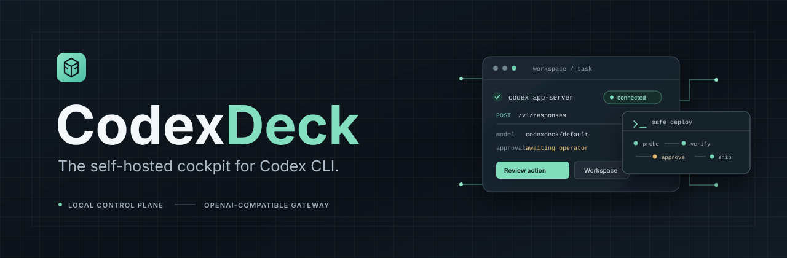
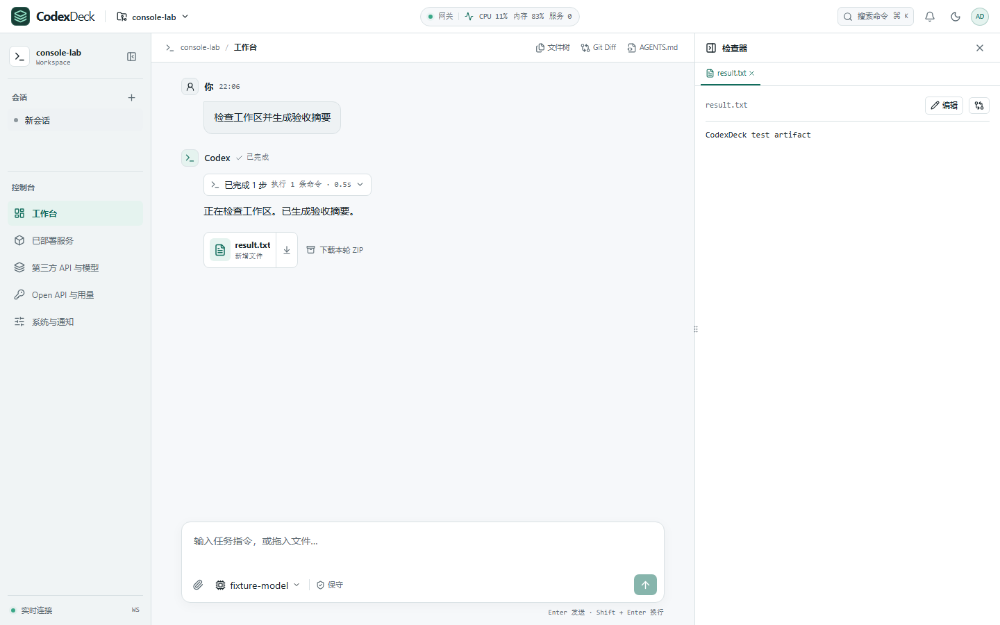
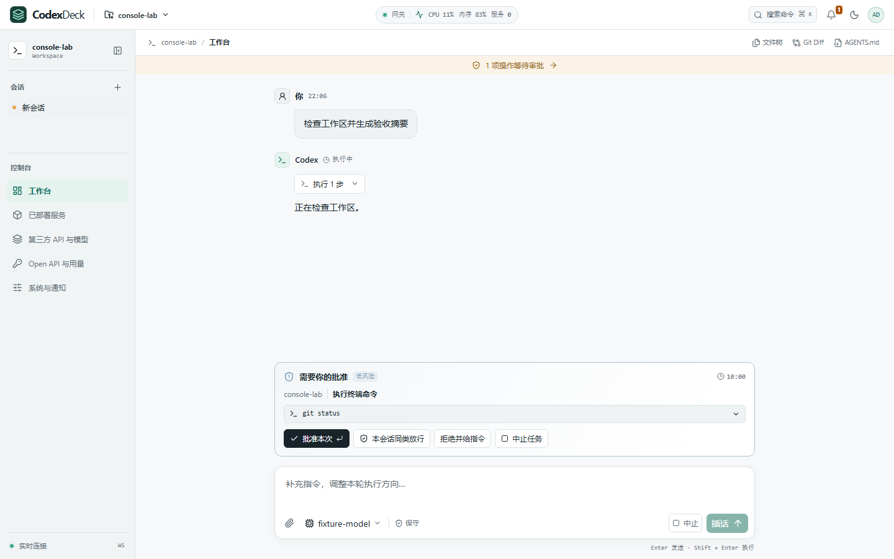
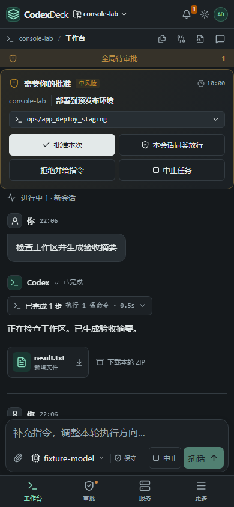
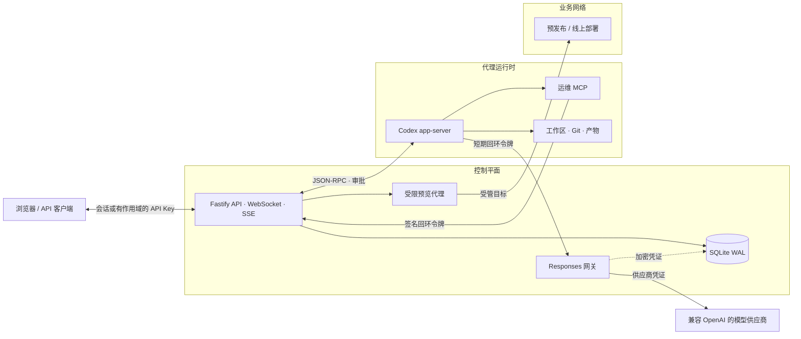

<div align="center">
  
  <h1>CodexDeck</h1>
  <p>面向 Codex CLI 的自托管 Web 控制台，集成兼容 OpenAI 的模型网关、远程审批和部署验收。</p>
  <p><a href="README.md">English</a> · <strong>简体中文</strong></p>
  <p>
    <a href="LICENSE"></a>
    <a href="https://github.com/Waffing/codex-deck/actions/workflows/ci.yml"></a>
    <a href="https://github.com/Waffing/codex-deck/pkgs/container/codex-deck"></a>
    <a href="#本地开发"></a>
    <a href="https://github.com/Waffing/codex-deck/stargazers"></a>
  </p>
  <p>
    <a href="#核心功能">核心功能</a> ·
    <a href="#快速开始">快速开始</a> ·
    <a href="#系统架构">系统架构</a> ·
    <a href="#安全模型">安全模型</a> ·
    <a href="#open-api">Open API</a> ·
    <a href="#路线图">路线图</a>
  </p>
</div>

## 快速开始

**Linux Docker Compose（amd64 或 arm64）**

```sh
curl -fsSL https://raw.githubusercontent.com/Waffing/codex-deck/main/deploy/install.sh | bash
```

安装器会在需要时安装 Docker 和 Compose 插件，并创建持久化目录。默认监听 `127.0.0.1:3000`，打开该地址后，按引导创建管理员、配置并探测模型供应商、选择工作区。首次初始化请通过可信连接完成，再开放远程访问。

Docker 安装依赖首个公开镜像，源码与原生安装可从 `main` 开始。版本标签触发发布后，GHCR 提供 `ghcr.io/waffing/codex-deck:latest` 与 `ghcr.io/waffing/codex-deck:latest-playwright`。需要 Chromium 验收时使用后者。

```sh
curl -fsSL https://raw.githubusercontent.com/Waffing/codex-deck/main/deploy/install.sh | bash -s -- --with-playwright
```

**Linux 原生安装（systemd）**。安装 Node.js 22+、Corepack、Git 和官方 Codex CLI，并确保 `codexdeck` 服务账户可以运行它们。

```sh
curl -fsSL https://raw.githubusercontent.com/Waffing/codex-deck/main/deploy/install.sh | bash -s -- --native
```

**使用 npx 运行本地 CLI**。npm 上的 `codex-deck` 已被另一个项目使用。构建源码后，将 npx 指向本仓库的 `packages/cli`，以离线模式启动。

```sh
git clone https://github.com/Waffing/codex-deck.git
cd codex-deck
pnpm install --frozen-lockfile
pnpm build
mkdir -p ./data ./workspaces
(
  umask 077
  if [ ! -s ./data/master.key ]; then
    openssl rand -hex 32 > ./data/master.key
  fi
)
export CODEXDECK_MASTER_KEY="$(cat ./data/master.key)"
NODE_ENV=production npx --offline --yes --package=./packages/cli -- codex-deck start --port 3000 --data ./data --workspaces ./workspaces
```

在另一个终端进入仓库根目录，运行 `npx --offline --yes --package=./packages/cli -- codex-deck status` 查看服务状态。将 `status` 换成 `doctor` 可检查运行环境。

<details>
<summary>HTTPS、升级和备份</summary>

启用 Compose HTTPS profile 时，配置 DNS，并将公网 TCP 80 和 443 分别转发到宿主机 8080 和 8443。为安装器传入 `--domain codex.example.com` 即可启用 Caddy，应用的宿主机监听地址仍为回环地址。

给[安装器](deploy/install.sh)传入 `--upgrade --dir /path/to/install` 可原地升级，传入 `--uninstall --dir /path/to/install` 可卸载。systemd 部署需要沿用 `--native`。备份数据目录、工作区和加密主密钥，并单独妥善保管主密钥，恢复时需要它解密供应商凭证。

</details>

## 核心功能

| 需求 | CodexDeck 的处理方式 |
| --- | --- |
| 接入仅支持 Chat Completions 的模型 | Codex 使用 Responses 协议访问本地网关。网关可以原样转发 Responses，也可将流式输出和工具调用转为 Chat Completions，并支持配置备用模型。 |
| 将供应商凭证与代理进程隔离 | 网关在发送上游请求时解密凭证。Codex 通过短期签名令牌访问本地网关。 |
| 在任务运行时审批敏感操作 | `codex app-server` 的审批请求以非阻塞卡片显示。待审操作暂停期间，控制台仍可继续使用。 |
| 交付产物并保留审计记录 | 检查文件和 Git 检查点，订阅可续传的任务事件，通过有作用域且会过期的签名链接下载产物。 |
| 部署后先验收再确认上线 | Server Probe 检查可用运行时。部署至预发布、检查 HTTP 和日志，按需启用 Playwright，并在发布验收失败时回滚。 |
| 离开电脑后继续审批 | 响应式控制台可在手机上查看任务、审批、日志和服务预览。 |

<p align="center">
  
</p>

<table>
  <tr>
    <td align="center"></td>
    <td align="center"></td>
  </tr>
  <tr><td align="center">桌面审批</td><td align="center">移动端审批</td></tr>
</table>

*截图来自使用合成测试数据的本地控制台。*

## 系统架构



Docker 模式下，控制平面通过独立内部网络上的 socket proxy 调用 Docker API。业务容器与 Caddy 位于业务网络。Caddy 将外部请求转发给控制平面，由控制平面解析预览和线上部署目标。

## 第三方 API 兼容矩阵

| 供应商预设 | CodexDeck 接入能力 | 推荐模式 |
| --- | --- | --- |
| OpenAI | 根据所选模型使用 Responses 透传或 Chat 转译 | `auto`，或对已验证的原生模型使用 `responses` |
| OneAPI / NewAPI | 兼容 OpenAI 的中转，端点和功能由上游路由决定 | 探测后用 `auto`，仅支持 Chat 的中转用 `chat` |
| OpenRouter | 可用的 Responses / Chat 端点取决于所选模型 | 探测所选模型后使用 `auto` |
| DeepSeek | 兼容 OpenAI 的 Chat Completions | `chat`，工具调用能力按模型确认 |
| Ollama | 可达的 Ollama 实例提供兼容 OpenAI 的端点 | 探测后用 `auto`，仅支持 Chat 的实例用 `chat` |

接入真实端点后请运行供应商探测，按模型确认流式输出、工具调用和图片能力。

## 安全模型

1. **凭证隔离。** 供应商 Key 和自定义请求头以 AES-256-GCM 加密存入 SQLite。网关为上游请求解密，Codex 只收到本地网关令牌。生产环境需要保留固定的 `CODEXDECK_MASTER_KEY`。
2. **文件访问边界。** 使用 `realpath` 检查工作区、数据库和导出产物的根目录边界，防止通过符号链接穿越目录。
3. **Docker 接口最小权限。** 控制平面通过内部网络的 `docker-socket-proxy` 使用允许的 Docker 接口。Docker 写权限仍属于宿主机高权限能力。
4. **预览代理的 SSRF 防护。** 代理只解析受管部署目标，检查预发布权限和端口归属，剥离浏览器凭证。浏览器验收限制请求访问部署本身的来源。
5. **凭证脱敏。** `SecretMasker` 对日志、持久化线程事件和发送给客户端的事件遮罩可识别的凭证。

漏洞请按 [SECURITY.md](SECURITY.md) 私下报告。

## Open API

在控制台的**Open API 与用量**页面创建 Key，并授权 `tasks:write`、`tasks:read` 与目标工作区。将 Key 和工作区 ID 放入本地环境变量 `CODEXDECK_API_KEY` 和 `WORKSPACE_ID`。以下 Bash 示例需要 `curl` 与 `jq`。

```bash
export CODEXDECK_URL=http://127.0.0.1:3000
: "${CODEXDECK_API_KEY:?请设置 CODEXDECK_API_KEY}"
: "${WORKSPACE_ID:?请设置 WORKSPACE_ID}"

TASK_ID=$(
  curl -fsS "$CODEXDECK_URL/api/v1/tasks" \
    -H "Authorization: Bearer $CODEXDECK_API_KEY" \
    -H "Content-Type: application/json" \
    --data "$(jq -nc --arg id "$WORKSPACE_ID" \
      '{workspace_id: $id, prompt: "概述项目并列出测试命令。"}')" \
  | jq -er '.task_id'
)

curl -fNsS "$CODEXDECK_URL/api/v1/tasks/$TASK_ID/stream" \
  -H "Authorization: Bearer $CODEXDECK_API_KEY" \
  -H "Last-Event-ID: 0"
```

创建任务返回 HTTP `202`，响应包含 `task_id` 和 `thread_id`。SSE 重连时传入最后处理的事件 ID。通过 `GET /api/v1/tasks/{task_id}` 查询状态和产物，读取签名下载地址还需 `files:download` 权限。任务可设置白名单中的 `webhook_url` 来接收签名回调。

## 本地开发

使用 Node.js 22+、Corepack 管理的固定 pnpm 版本以及 Git。执行真实代理任务还需要官方 Codex CLI。

```sh
corepack enable
pnpm install --frozen-lockfile
pnpm typecheck
pnpm build
pnpm test
```

在不同终端运行 `pnpm dev:server` 和 `pnpm dev:web`。API 默认监听 `127.0.0.1:3210`，Vite 会代理开发环境的 API、WebSocket 和预览请求。安装兼容的 Playwright Chromium 后，可运行 `pnpm e2e` 使用本地测试夹具验收控制台。

## 路线图

- [x] **V1 基础能力** · 协议网关、凭证隔离、审批、签名产物、Open API 和部署验收。
- [x] **V1 控制台** · 桌面工作台、移动端审批、供应商探测和可续传事件。
- [ ] **V1 发布** · 验证两种目标架构上的容器启动、发布镜像并确定可用的 npm 包名。
- [ ] **V2 规划** · 加强业务容器隔离、扩充供应商兼容性覆盖并改进部署恢复。

## 贡献与许可证

参阅[贡献指南](CONTRIBUTING.md)了解检查和提交流程。CodexDeck 使用 [MIT 许可证](LICENSE)。

[](https://star-history.com/#Waffing/codex-deck&Date)

